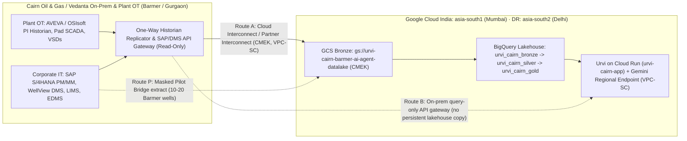
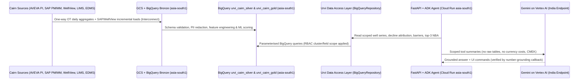

# Urvi · Data Access & India Data Residency Plan (Cairn Oil & Gas, Barmer Basin)

**Document:** `docs/data_access_plan.md` · **Date:** 2026-11-15 · **Status:** Draft for architectural alignment  
**Scope:** Urvi AI Agent for **Cairn Oil & Gas (Vedanta Limited)** — **Barmer Basin (`RJ-ON-90/1`, Rajasthan)**: **Mangala**, **Bhagyam**, **Aishwariya**, and **Raageshwari** (460 producing wells across MBA oil & RDG gas/condensate), plus future scale to Ravva, Cambay, and Jorhat blocks.  
**Regulatory Baseline:** Digital Personal Data Protection Act 2023 (**DPDP Act 2023**), NCIIPC / IT Act s.70 Critical Information Infrastructure guidance, CERT-In Directions (28 Apr 2022), and Vedanta Information Security & Data Classification Policy **[verify]**.

> [!IMPORTANT]
> **Answer first: Urvi should read a governed, read-only "Well Health & Intervention" data product from Vedanta's Enterprise Data Lakehouse in Google Cloud India (`asia-south1` Mumbai), rather than building brittle point-to-point connections into plant OT networks.**
> Operational telemetry (**AVEVA / OSIsoft PI Historian & Pad SCADA** at MPT Nagana, RGT, BHG-CPF, ASH-CPF, and Jet-Pump/ESP VSDs), **SAP S/4HANA PM/MM** (work orders, rig calendar, MRO spares), and **Subsurface / WellView DMS** **[verify]** land inside an India-resident lakehouse (`gs://urvi-cairn-barmer-ai-agent-datalake` and BigQuery `urvi_cairn_{bronze,silver,gold}` in `asia-south1` Mumbai, with `asia-south2` Delhi DR). Until live OT/ERP ingestion is wired, a **Pilot Bridge (Route P)**—a masked historical extract of Barmer wells landed in `asia-south1`—validates recommendation quality in 4–6 weeks without touching live control networks.

---

## 1. The Answer on One Page

| Question | Answer |
|---|---|
| **Where does real Barmer data come from?** | Cairn / Vedanta's operational and engineering systems (§3): **AVEVA / OSIsoft PI Historian & Pad SCADA** (MPT Nagana, RGT, VSDs, wellhead/choke pressures & waxy crude WHT), **SAP S/4HANA PM/MM** (work orders, rig schedules, spares MRO), **Production Allocation / DPR**, **LIMS** (HPAM polymer residual, wax WAT/pour point, H2S/CO2), and **Subsurface / WellView DMS** **[verify]** (completions, directional surveys, CBL scans, barrier tests, SOPs). Today Urvi runs on **synthetic** Barmer data matching these exact schemas. |
| **How does Urvi fetch it?** | Through a single governed repository boundary (`backend/app/data_access/`): **Parquet** (local/container), **BigQuery** (`urvi_cairn_{bronze,silver,gold}` in `asia-south1`), or an **Enterprise Data Lakehouse Consumption API adapter** (Route A/B). Urvi's 30+ analytics tools never issue direct queries against SCADA, PI, or SAP transactional DBs (§5). |
| **Does it satisfy India data residency?** | **Yes, by design.** All storage, BigQuery datasets, GCS buckets, CMEK keys, logs (≥ 180-day retention), VPC-SC perimeters, and Gemini inference endpoints stay physically inside Google Cloud India regions (**`asia-south1` Mumbai** / **`asia-south2` Delhi**) (§6). |
| **How is OT / SCADA separated from AI?** | Raw high-frequency OT/SCADA tags and alarm/trip setpoints stay inside Cairn's plant OT/DMZ boundary. Only **read-only derived hourly/daily aggregates** and static well engineering records cross via a one-way historian replicator / API gateway (§4.1). Urvi has zero write path to SCADA, VSDs, or SAP. |
| **What do we do before live PI/SAP wiring?** | **Pilot Bridge (Route P):** Export 6–12 months of de-sensitised historical records for 10–20 Barmer wells (e.g., Mangala/Bhagyam waxy-crude and polymer-flood producers) into an isolated `asia-south1` bucket (`gs://urvi-cairn-barmer-ai-agent-datalake` pilot project). Zero live OT connectivity needed. |
| **What changes from demo to production?** | Move Cloud Run (`urvi-cairn-app`) and Gemini Live from `us-central1` (used in the synthetic demo only because Live regional rollout is tracked separately) into `asia-south1`, enforce **CMEK / Cloud EKM**, **VPC Service Controls**, **Access Approval**, and **IAP + Vedanta SSO / Okta / Azure AD** mapped to Urvi's three RBAC roles (§8). |

---

## 2. Sovereignty, Compliance, and Enterprise Controls

Because **Cairn Oil & Gas (Vedanta Limited)** is a private upstream operator, government-PSU procurement circulars (such as MeitY PSU-cloud circulars) do not govern directly in the same way, **but India residency, critical-infrastructure security, and DPDP Act 2023 obligations apply strictly**:

| Requirement / Policy | What it requires | How Urvi satisfies it |
|---|---|---|
| **India Data Residency** | Raw, curated, and consumption datasets, embeddings, prompts, tool payloads, backups, and audit logs remain inside India. | Org Policy Resource Location Constraint restricted to **`asia-south1` (Mumbai)** and **`asia-south2` (Delhi)**; GCS + BigQuery (`urvi_cairn_*`) + Artifact Registry + Cloud Logging pinned to India. |
| **DPDP Act 2023** | Personal data of field engineers, rig supervisors, and contractors in daily workover reports (DWRs) and shift handovers must be minimised and protected. | Pseudonymise / strip personnel names, phone numbers, and contractor commercial identifiers at Bronze → Silver ingestion; only role identifiers (`FIELD_ENGINEER`, rig IDs `RIG-BARMER-xx`) enter Silver/Gold. |
| **NCIIPC / OT Isolation (IT Act s.70)** | Oil & gas processing terminals (MPT Nagana, RGT) and pipeline SCADA are critical infrastructure; AI workloads must not introduce a control path. | **Strictly read-only & advisory.** No OPC-UA write path, no VSD setpoint commands, and no SAP work-order auto-commit; human engineers review and approve every intervention. Confirm protected-system boundary with Cairn OT Security **[verify]**. |
| **CERT-In Directions (28 Apr 2022)** | Security incident telemetry and audit logs retained for **≥ 180 days in India**. | Cloud Audit Logs + application decision logs routed to regional `asia-south1` Cloud Logging buckets (`retention >= 180 days`) and exported to Vedanta SOC / SIEM. |
| **Commercial & Cost Confidentiality (`D-1`)** | Exact vendor rates, AFE currency budgets, and contract pricing must not leak into LLM context or UI. | Urvi surfaces **qualitative cost bands (`LOW` / `MED` / `HIGH`)** and rig-days only—never INR/USD point estimates. |

---

## 3. Barmer Source Systems Inventory (`[verify]` with Cairn IT / OT)

Urvi's Silver & Gold analytical schemas (`backend/app/analytics/lakehouse/`) map directly to Cairn Oil & Gas operational systems across Barmer (`RJ-ON-90/1`):

| Urvi Table / Feature | Engineering Content | Likely Cairn / Vedanta Source | Interface / Format | Current Zone | Derived Cloud Classification |
|---|---|---|---|---|---|
| `daily_production`, `well_tests` | Oil / gas / water rates, water cut, uptime, deferred bbl, fluid level | Production Allocation / DPR & Meter Proving (MPT Nagana / RGT) **[verify]** | Batch SQL / CSV / REST | On-prem / Corporate IT | Curated daily well rates (sensitive operational IP; India-resident CMEK) |
| Telemetry (`thp`, `chp`, `wht_degc`, `esp_*`, `pcp_*`, `jet_*`, `gl_inj_*`) | Wellhead temperature (`42°C` pour point / `59°C` WAT monitoring), Jet Pump / ESP / PCP / SRP / Gas Lift telemetry | **AVEVA / OSIsoft PI Historian & Pad SCADA** (MPT, RGT, `BHG-CPF`, `ASH-CPF`, well pad RTUs/VSDs) | PI Web API / OPC UA HDA / MQTT bridge | Plant OT / DMZ | **Raw OT stays in OT DMZ**; read-only **hourly/daily aggregates** replicate one-way to `asia-south1` Bronze |
| `well_master`, `construction`, `formation_tops`, `tubing_tally`, `deviation_survey` | Casing, tubing joints, perforations, packers, `Barmer_Hill` horizontal trajectories, `Fatehgarh` & `Raageshwari_Volcanics` tops | **Subsurface / WellView DMS**, Petrel / OpenWorks **[verify]** | WITSML / REST / CSV / Excel | Subsurface IT | Static engineering model in `urvi_cairn_silver` (coordinates optionally masked for pilot) |
| `workover_history`, `barrier_tests`, `wellhead_rating`, `fishing_records` | Past jobs (`IC-01`..`IC-15`), rig-days, annular barrier pass/fail (`RAG-014`), wellhead PSI ratings | **WellView DMS** & **SAP S/4HANA PM** (Work Orders) **[verify]** | SAP OData / IDoc / WellView API | Corporate ERP / Subsurface | Operational history (strip contractor pricing & personnel PII) |
| `rig_calendar`, `mro_inventory`, `well_run` | Workover rig schedule (`RIG-BARMER-01..15`), spares stockouts (e.g., cement retainers, jet pump nozzles), run status | **SAP S/4HANA PM / MM** | SAP OData / CDC (SLT / Datastream) | Corporate ERP | Curated availability & stockout flags only (no PO prices) |
| `fluid_hazards` | Wax pour point / WAT, HPAM polymer breakthrough ppm, biogenic `H2S` (8–35 ppm), RDG `CO2` (2–6 mol%) & BHT | **LIMS / Lab Oilfield Chemistry** **[verify]** | CSV / LIMS API | Lab / Corporate IT | Curated hazard flags & concentrations |
| `documents` & `sop` | Completion reports, scanned CBL logs (`DOC-CBL-MNG042-2014`), RCAs, 14 Barmer SOPs | **Documentum / SharePoint / WellView EDMS** **[verify]** | PDF, TIFF, YAML + metadata | Corporate DMS | Indexed in `asia-south1` GCS + Vertex AI Search / local hybrid index (CMEK) |
| Map geometry | Field boundaries, pad polygons (`MNG-PAD-*`, `BHG-PAD-*`, `ASH-PAD-*`, `RAG-RDG-*`), flowline network | Corporate GIS / ArcGIS **[verify]** | GeoJSON / Shapefile | Corporate IT | `urvi_cairn_silver` geodata (offset/synthetic in demo) |

---

## 4. Integration Routes (India-Resident)

| Route | When to use | Data flow | Residency & Security Posture | Effort / Dependency |
|---|---|---|---|---|
| **A. Vedanta Lakehouse in `asia-south1` (Recommended Target)** | Production deployment across Mangala, Bhagyam, Aishwariya, and Raageshwari | OT DMZ & SAP CDC → `gs://urvi-cairn-barmer-ai-agent-datalake` → BigQuery `urvi_cairn_{bronze,silver,gold}` (`asia-south1`) → `BigQueryRepository` → Urvi (`urvi-cairn-app`) | Data at rest & in transit pinned to India; CMEK/EKM held by Vedanta; VPC-SC perimeter; private Interconnect | Medium; aligns directly with existing `BigQueryRepository` & `deploy/bq_sql/` DDLs |
| **B. On-Prem API Gateway + Cloud AI** | If Vedanta mandates raw historian/well logs remain strictly inside Gurgaon/Barmer DCs | Urvi (in `asia-south1` Cloud Run) queries curated per-well slices on demand via authenticated REST/GraphQL gateway over Cloud Interconnect | Zero persistent raw storage in cloud; session context ephemeral & CMEK-protected in India | Higher API latency; requires a new `LakehouseApiRepository` adapter implementing `WellRepository` |
| **P. Pilot Bridge (Immediate Next Step)** | Pre-integration validation in 4–6 weeks on real Barmer wells without OT network changes | Export 6–12 months of de-sensitised data for 10–20 Barmer wells (e.g., high-water-cut Mangala polymer wells + waxy Bhagyam PCP/ESP wells) → encrypted upload to isolated `asia-south1` GCS pilot bucket | Isolated India project, Vedanta-controlled CMEK, PII stripped, auto-expires after pilot | Low (4–6 weeks); zero live link into plant SCADA or SAP |

### 4.1 OT / IT Data Minimisation Rules
1. **No raw sub-minute SCADA or control configuration** (alarm limits, PLC/RTU logic, IP schemas) leaves the plant OT DMZ.
2. **Daily/hourly derived telemetry only:** THP, CHP, WHT (`°C`), pump speed/current/frequency, gas-lift injection, and allocated oil/gas/water rates.
3. **No financial point values (`D-1`):** SAP work-order costs collapse to `LOW` / `MED` / `HIGH` bands prior to Silver.
4. **Read-only guarantee:** Urvi authenticates with read-only service principals; no mutation API exists toward PI, SCADA, or SAP.

---

## 5. End-to-End Target Request & Data Flow (Route A)

**Code readiness:** `backend/app/data_access/` already abstracts all 30+ analytics tools behind `WellRepository` (`ParquetRepository` and `BigQueryRepository` querying `urvi_cairn_{bronze,silver,gold}`), so moving from synthetic Parquet to real Barmer BigQuery tables requires swapping `DATA_BACKEND=bigquery` and populating `urvi_cairn_bronze` / `urvi_cairn_silver` / `urvi_cairn_gold`.

---

## 6. India Residency & Security Controls Matrix

| Control | Google Cloud Mechanism | Protection Provided |
|---|---|---|
| **India-Only Compute & Storage** | Org Policy `constraints/gcp.resourceLocations` (`in:asia-south1`, `in:asia-south2`) | Prevents accidental bucket, BigQuery dataset, VM, or log creation outside India |
| **Customer-Managed Keys** | **CMEK** (Cloud KMS `asia-south1`) or **Cloud EKM** with Vedanta-owned external HSM | Vedanta retains cryptographic key custody and revocation control over BigQuery, GCS, and Cloud Run artifacts |
| **Zero Exfiltration Perimeter** | **VPC Service Controls (VPC-SC)** around BigQuery, GCS, Vertex AI, Artifact Registry, and Cloud Run | Blocks cross-project/internet data exfiltration even with valid credentials |
| **Private Network Ingress** | **Cloud Interconnect** + Private Service Connect + Internal Load Balancer | No public internet exposure for OT/ERP ingestion or corporate browser access |
| **Model Processing & Zero Training** | **Vertex AI India Regional Endpoints** + zero-data-retention / no-training enterprise commitment | Prompts and Barmer well telemetry never train foundation models and remain in India |
| **Access Transparency & Approval** | **Access Transparency + Access Approval** | Any Google support access requires explicit Vedanta cryptographic approval and is audit-logged |
| **Persona RBAC & Corporate SSO** | **Identity-Aware Proxy (IAP) + Vedanta SSO (Azure AD / Okta)** mapped to Urvi RBAC | Enforces role scope per tool: *COO / CIO* (`ED`), *Asset Manager — Barmer* (`ASSET_MANAGER`), *Production / Well Services Engineer* (`FIELD_ENGINEER`, cluster-scoped) |
| **180-Day India Audit Trail** | Regional Cloud Logging sink (`asia-south1`, `>= 180d`) → Vedanta SIEM | Full traceability of user queries, tool calls, RBAC denials, and recommendation rationale |

---

## 7. Phased Rollout Plan

| Phase | Scope | Route | Data & Environment | Exit Deliverable |
|---|---|---|---|---|
| **0. Synthetic Showcase (Now)** | 460 Barmer wells (`Mangala`, `Bhagyam`, `Aishwariya`, `Raageshwari`), 60 months | Synthetic Parquet + BigQuery (`asia-south1`) | `urvi-cairn-app` synthetic demo + 14 Barmer SOPs + ML Gate Q/E models | End-to-end Barmer demo validated against all BDD & golden contracts |
| **1. Pilot Bridge** | 10–20 masked historical Barmer wells (6–12 months) | **Route P** | `asia-south1` isolated pilot GCS + BigQuery `urvi_cairn_*` | Side-by-side accuracy & physics calibration review with Cairn Barmer reservoir/production engineers |
| **2. Lakehouse Integration** | Live Mangala + Bhagyam feed (PI daily aggregates + SAP PM + WellView) | **Route A** | `DATA_BACKEND=bigquery`, Cloud Interconnect, IAP + Vedanta SSO, CMEK, VPC-SC | Production pilot in `asia-south1` for Asset Manager & Pad Engineers |
| **3. Basin & India Scale** | Full Barmer (MBA + RDG) + Ravva, Cambay, and Jorhat blocks | **Route A / B** | Multi-asset `urvi_cairn_*` lakehouse + automated ML retraining | Production rollout across Cairn Oil & Gas India assets |

---

## 8. Demo vs. Production Deployment Gaps

| Area | Synthetic Demo Today | Production Target (Cairn / Vedanta) | Action Required |
|---|---|---|---|
| **Cloud Run Region** | `us-central1` (`urvi-cairn-app` — synthetic demo only, because Gemini Live regional availability is tracked separately) | **`asia-south1` (Mumbai)** with `asia-south2` DR | Deploy Cloud Run & Live proxy into `asia-south1` once Gemini Live India endpoint is enabled |
| **Gemini Endpoints** | `gemini-3.8-flash` / `gemini-3.8-live` (synthetic demo) | India regional Vertex AI endpoints (`asia-south1`) | Pin `VERTEX_LOCATION=asia-south1` in production Cloud Run env |
| **Data Store** | Synthetic Parquet + BigQuery `urvi_cairn_{bronze,silver,gold}` (`asia-south1`) | Live `urvi_cairn_*` populated from PI / SAP / WellView (no data baked into container image) | Set `DATA_BACKEND=bigquery`; remove bundled demo parquet from production Dockerfile |
| **Identity & RBAC** | Public demo URL + UI persona switcher | **IAP + Vedanta SSO** mapping IdP groups to `ED`, `ASSET_MANAGER`, `FIELD_ENGINEER` | Disable demo persona override header when `ENV=prod` |
| **Keys & Network** | Google-managed keys | **CMEK / Cloud EKM**, **VPC-SC**, **Access Approval**, private ingress | Provision via Terraform (`deploy/`) in Vedanta GCP landing zone |
| **Session State** | In-memory single instance | Memorystore (Redis, CMEK, `asia-south1`) | Wire Redis session store for horizontal Cloud Run scaling |

---

## 9. Open Verification Items for Cairn Oil & Gas (`[verify]`)

1. **Exact Source System Ownership:** Confirm exact PI AF hierarchy names for `MPT-NAGANA`, `RGT-TERMINAL`, `BHG-CPF`, `ASH-CPF`, SAP S/4HANA PM/MM order codes (`IC-01`..`IC-15` mapping), and WellView DMS API/export endpoints.
2. **Data Classification Sign-Off:** Confirm Vedanta Information Security classification for daily aggregated well telemetry vs. static wellbore records under `asia-south1` CMEK + VPC-SC.
3. **Pilot Well Selection:** Identify 10–20 representative Mangala/Bhagyam/Aishwariya/Raageshwari wells for **Route P** retrospective validation against historical workover outcomes.
4. **Regional Gemini Live Availability:** Confirm GA timeline for `gemini-live` in `asia-south1` prior to production voice cutover (text ADK agent runs regionally in `asia-south1`).
