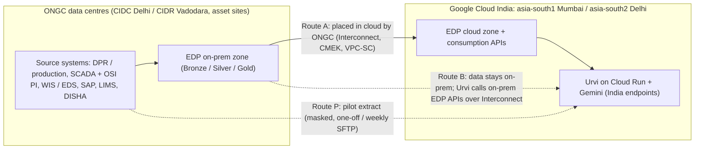
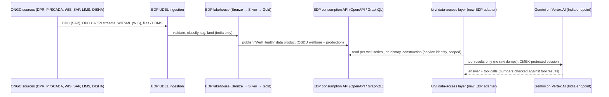

# Urvi · Data Access Plan: where the data comes from, how we fetch it, how it stays in India

**Document:** `docs/data_access_plan.md` · **Date:** 2026-11-15 · **Status:** Draft for discussion (no build)  
**Scope:** Urvi AI Agent on WellPulse, ONGC Assam Asset (Geleki, Lakwa, Lakhmani) first. Barmer / Vedanta Oil and Gas (BL-9) is noted only in §10.  
**Inputs:** ONGC EDP RFP `ZV7AL26011` (CPPP `2026_ONGC_293069_1`, SOW §2, §3.1.2, §3.2.6, Annex A, Annex H) in [`~/ONGC_Data_Platform_RFP`](file:///usr/local/google/home/amandeepsinghs/ONGC_Data_Platform_RFP/gcp%20working%20files/ONGC_EDP_RFP_Complete_Analysis.md) · MeitY cloud-selection OM of 20 Mar 2026 and the Category A→B method in [`FCC …/use_cases/CATEGORY_A_TO_B.md`](../../FCC%20Agentic%20Optimisation/use_cases/CATEGORY_A_TO_B.md) · the ONGC sovereignty brief in [`Drilling-Intelligence-2.0/sovereignity.md`](../../Drilling-Intelligence-2.0/sovereignity.md).

> [!IMPORTANT]
> **Answer first: Urvi should not build its own pipes into ONGC's source systems. It should be a consumer of ONGC's Enterprise Data Platform (EDP), which ONGC is tendering now.** The EDP RFP already lists Urvi's job as a named use case: Annex H 1.5 "**Well Health & Opportunity**: integrated well-health monitoring, consolidates rates, pressure, lift and job history to identify underperforming wells early". Urvi reads a governed "well health" data product from the EDP consumption layer (APIs, as the RFP requires). It runs in Google Cloud India regions (Mumbai `asia-south1` / Delhi `asia-south2`), which the RFP explicitly accepts as India-resident (§3.2.6). Until the EDP is live, a **pilot bridge** (a de-sensitised extract of a few Assam wells, landed in the India region) proves the value. **AI runs in the cloud**, exactly as the RFP places it (on-prem for operational and regulatory workloads; cloud for analytics, AI/ML: §3.1.2(d), §3.1.3). Category A raw data (e.g. raw SCADA / OT) stays in the EDP on-prem zone; Urvi uses derived data that ONGC places in the cloud zone, or queries the on-prem EDP API over the private link (Route B).

---

## 1. The answer on one page

| Question | Answer |
|---|---|
| **Where does the data come from?** | ONGC's own systems: production / DPR and allocation, SCADA and OSI PI telemetry, WIS / EDS well master and construction, workover and job history, SAP (work orders, materials, rigs), LIMS, and DISHA EDMS documents (§3). Today Urvi uses **synthetic** data shaped like these. |
| **How will we fetch it?** | **Through the EDP**, not point-to-point. The EDP ingests the sources (CDC for SAP, OPC UA / PI streaming for SCADA, WITSML for WIS, file and EDMS loaders) into Bronze → Silver → Gold, and publishes a **Well Health data product**. Urvi's existing data-access layer gets one new adapter that calls the EDP consumption APIs (§5). |
| **Does it satisfy data residency?** | **Yes, by design.** Every route keeps data, metadata, logs and backups in India, under ONGC-held keys, inside a VPC Service Controls perimeter, with no cross-border support access (RFP §3.2.6). Gemini runs on India regional endpoints with no training on customer data (§6). |
| **What if ONGC says some data is Category A?** | That raw data stays in the EDP on-prem zone. Urvi still runs in the India cloud region: it uses a **derived** dataset ONGC places in the cloud zone (§4.1), or reads only the rows it needs from the on-prem EDP API over Interconnect (Route B). The RFP puts AI/ML in the cloud; there is no on-prem AI runtime in scope. |
| **What do we do before the EDP exists?** | **Pilot bridge (Route P):** ONGC exports 6–12 months of a few mature Assam wells (names masked) to a landing bucket in `asia-south1`. Urvi runs on it in 4–6 weeks. No live connection into ONGC networks. |
| **What must change in Urvi itself?** | The production deployment runs in India regions (Cloud Run and Gemini in `asia-south1` / `asia-south2`), with CMEK, VPC-SC, IAP / SSO, an EDP API adapter and audit logs kept in India (§8). The demo deliberately runs in `us-central1` because Gemini Live is not yet offered in India regions; it uses only synthetic data. |

---

## 2. What the RFP and the rules require (the constraints we design to)

### 2.1 ONGC EDP RFP (`ZV7AL26011`, bid due 3 Dec 2026)
| RFP clause | Requirement (quoted or close paraphrase) | What it means for Urvi |
|---|---|---|
| **§3.1.2 Hybrid mandate** | ONGC "has decided that hybrid architecture is the most appropriate", driven by "regulatory and sovereignty requirements (DPDPA, MeitY, ONGC IS Policy) and the need to keep certain critical/OT datasets within ONGC data centers", low-latency access to SCADA, PI, Petrel, CMG, SAP, EDMS, and (d) "the requirement to leverage cloud elasticity for analytics, AI/ML and cross domain use cases". | Some well data will live **only on-prem**; Urvi (in the cloud) reaches it through the EDP, never directly. |
| **§3.1.3 Architecture overview** | "integrates on premise high performance compute (for operational and regulatory workloads) with cloud scalability (for analytics, AI/ML and archival workloads)". | **AI runs in the cloud.** Urvi and Gemini belong in the Google Cloud India regions. |
| **§3.2.6 Residency** | "All EDP data (including raw, curated and consumption layers), metadata, logs and backups shall remain resident within India at all times"; geo-fenced; no transfer, replication, access or processing outside India without written ONGC approval. | Urvi's prompts, tool results, session state, logs and model calls are **all EDP data in motion** and must stay in India. |
| **§3.2.6 Hyperscaler India regions** | Workloads "hosted in hyperscaler regions physically located in India (e.g. … GCP India region), when procured through ONGC approved commercial and security arrangements, shall be considered permissible India resident infrastructure". | Google Cloud Mumbai / Delhi is **explicitly acceptable**. |
| **§3.2.6 Extra controls** | ONGC "may apply additional controls for workloads hosted outside ONGC owned data centres (e.g. enhanced encryption, access approvals, network segmentation, monitoring and auditability)". | Bring CMEK / EKM, Access Approval, VPC-SC and India-resident audit logs **by default** (§6). |
| **§3.2.6 No cross-border movement** | Includes "vendor support access, telemetry exports or troubleshooting exports". | No support tickets with data attached, no telemetry export, no US-region logging sinks. |
| **§3.2.6 Evidence** | Data-flow diagrams (on-prem, cloud, hybrid), encryption and key management, IAM / RBAC, logging, exception procedure. | §5 and §6 of this plan are the start of that evidence pack. |
| **Consumption layer** | Access via OpenAPI / GraphQL / gRPC / MQTT gateway and a BI semantic layer; **no direct database queries**. | Urvi reads **APIs**, not tables. |
| **SCC Cl. 5** | ONGC alone decides final dataset / workload placement (on-prem vs. cloud). | Urvi must support **both** placements (Routes A and B). |
| **§3.2.2(6) AI scope** | EDP delivers AI/ML **foundation** only (APIs, feature store, model registry, GPU-ready compute); Annex H use cases are built on top. | Urvi is the **use-case layer** on top of the EDP, not part of the EDP bid itself. |
| **§3.1.8 / §7.1.1 No lock-in** | Open formats (Parquet, Avro, Iceberg …), containers, Terraform; proprietary services disclosed with migration paths. | Urvi's tools already run on parquet / BigQuery via one repository interface. Keep it that way. |

### 2.2 Government rules
| Rule | What it says | Effect on Urvi |
|---|---|---|
| **MeitY OM 9(3)/2025-EG-II, 20 Mar 2026** (cloud selection) | Classify first. **Category A** (harm to security, business continuity, significant financial loss) → government / PSU-onboarded / notified sovereign cloud. **Category B** → also MeitY-empanelled public cloud. Addressed to ministries; the data owner classifies (para 6). | ONGC classifies Urvi's dataset. We design so a **derived well-performance dataset** can reasonably be Category B (§4.1). |
| **CERT-In Guidelines for Government Entities (June 2023)** | Covers PSUs. Host in government DCs or **MeitY-empanelled** CSPs; no data movement between networks of different classification. | Google Cloud India qualifies. Keep OT (Category A) and the cloud dataset separate; the only crossing is one-way through a controlled gateway. |
| **CERT-In Directions (28 Apr 2022)** | Incidents reported within 6 h; logs kept **180 days in India**. | Log sinks in India regions with ≥ 180-day retention. |
| **IT Act s.70 / NCIIPC** | Energy is a critical sector. If a system is a notified protected system, a new data path needs steering-committee approval. | Urvi is **read-only and advisory**; it never writes to SCADA / DCS. Confirm protected-system status with ONGC Infocom. **[verify]** |
| **DPDP Act 2023** | Personal data protection. | Crew and supervisor names in DWRs / job logs are personal data: pseudonymise them before they cross, or keep them on-prem. |

---

## 3. What data Urvi needs and where it lives in ONGC today

Urvi's tools already read these tables (synthetic today). The right-hand columns map each one to the ONGC system named in the RFP (SOW §2, Annex A). Owners and exact system names are **[verify with ONGC Assam Asset / Infocom]**.

| Urvi table / feature | What it is | Likely ONGC source (RFP Annex A) | Format / interface (Annex A) | Location today | Proposed class of the **derived** dataset |
|---|---|---|---|---|---|
| `daily_production`, well tests | Oil / gas / water rates, water cut, uptime, allocation | Production monitoring / DPR and allocation feeds; OPMAC **[verify]** | CSV, XML, proprietary exports | On-prem | B candidate (daily, per well; asset totals are already public via PPAC / DGH) |
| Pressures, WHT, gas-lift injection | THP, CHP, FBHP / SBHP, temperature, GL rate | **SCADA, OSI PI** | OPC UA / DA / HDA, PI SDK / AF, MQTT | On-prem (OT) | **Raw = A** (OT). Derived **daily / hourly aggregates = B candidate** |
| Well master, construction, completion, formation tops, deviation, tubing tally | Casing, tubing, perforations, packer, lift type, TD | **WIS**, **EDS (Epinet)**, Petrel / G&G | WITSML, CSV, Excel, XML | On-prem (Dehradun / asset) | B candidate (static engineering data; coordinates can be offset) |
| Workover and job history (`workover_history`) | Job type, dates, rig-days, outcome | WIS / well services records, SAP PM work orders **[verify]** | IDoc, OData, BAPI, CSV | On-prem | B candidate (remove contractor names and costs) |
| Rig and material waits, schedules | Rig calendar, waiting on rig / material | SAP (PM / MM), Primavera P6 | IDoc / OData, XER | On-prem | B candidate |
| Cost band | LOW / MED / HIGH only | SAP FI / CO | OData | On-prem | B (bands only; no ₹ values ever, per D-1) |
| Lab / fluids, wax and sand | Water analysis, wax / sand flags | LIMS | CSV / DB | On-prem | B candidate |
| Documents (completion reports, CBL, RCA, SOPs) | PDFs, scans | **DISHA EDMS** | PDF, DWG, TIFF + CSV metadata | On-prem | Mixed: SOPs may stay on-prem (cited by reference, as in the FCC design) |
| Map geometry | Field / cluster boundaries, well positions | GIS / EDS | GeoJSON / shapefile | On-prem | B candidate with coordinate offset, or kept on-prem |

**Volume is small.** Urvi needs per-well daily data and static well records: megabytes to low gigabytes per asset, not the 38 PB seismic estate. That makes every route below cheap to run.

---

## 4. The routes: ways to get the data that meet residency

| Route | When to use it | How the data flows | Where Urvi and Gemini run | Residency position | Effort / dependency |
|---|---|---|---|---|---|
| **A. EDP cloud zone (recommended target)** | ONGC classifies the derived well-health product as **B** and places it in the EDP cloud zone (SCC Cl. 5) | Sources → EDP UDEL → Bronze / Silver / Gold → **Well Health data product** → EDP consumption API → Urvi | Cloud Run + Vertex AI Gemini in `asia-south1` / `asia-south2` | India region (RFP §3.2.6 permissible), CMEK, VPC-SC, India logs | Needs EDP Phase 1–2 live. Lowest run cost; best performance |
| **B. EDP on-prem, Urvi in cloud** | ONGC keeps the data in its DCs but allows **query results** to be processed in the India cloud | Urvi calls the **on-prem** EDP API over Cloud Interconnect (2 × 1 Gbps in the RFP); only the rows needed for one answer travel, encrypted; nothing is stored in the cloud beyond the session | Cloud Run + Gemini in India regions | Data at rest stays on-prem; processing in India region; same controls as A | Needs Interconnect + API gateway; slightly higher latency |
| **P. Pilot bridge (before the EDP)** | Now, to prove value on real data in weeks | ONGC exports 6–12 months for 10–20 **mature / legacy Assam wells**, names masked (Well-Alpha …), coordinates offset, people removed → SFTP / transfer appliance → GCS `asia-south1` landing → BigQuery Silver → Urvi's existing parquet / BigQuery adapter | Cloud Run + Gemini in India regions, separate pilot project | India only; ONGC-held keys; deleted at pilot end | 4–6 weeks; no live link into ONGC networks; light approvals (as advised in `sovereignity.md`) |

### 4.1 Why the derived well-health dataset can be Category B (to be decided by ONGC)
Using the harm-based method from the FCC paper (MeitY OM categories, NIST SP 800-188, ISO/IEC 20889):
- **Leave out (basis):** SCADA control configuration, alarm and trip limits, network and asset inventories, contractor and commercial terms, ₹ costs, people's names.
- **Generalise:** costs → LOW / MED / HIGH band; telemetry → daily / hourly aggregates; exact coordinates → offset positions.
- **Already public:** field and asset production totals (PPAC / DGH monthly). So per-well daily rates add limited new harm.
- **Read-only:** Urvi never writes to SCADA / DCS, so there is no control path to protect.

ONGC's classification authority signs the decision. The dataset is re-reviewed when tags, joins or use cases change.

---

## 5. How the fetch works in the target (Route A / B)

**What changes in Urvi's code (small):**
1. **New `edp` backend** next to `parquet` and `bigquery` in `backend/app/data_access/` (the repository interface already isolates the 30+ tools from storage). Config: `DATA_BACKEND=edp`, plus API base URL and an auth audience.
2. **Data contract.** One "Well Health" data product schema agreed with the EDP team (field names follow our current landing tables and OSDU wellbore / production entities). The existing golden-schema tests become the contract tests.
3. **Caching inside the boundary only.** Per-session in-memory cache. If a cache is needed, use Memorystore in the same India region under CMEK.
4. **Documents.** Search via Vertex AI Search in an India region over the EDMS extract, or keep SOP text on-prem and cite it by reference (Route B).

---

## 6. Residency and security controls (evidence for RFP §3.2.6)

| Control | Google Cloud mechanism | Satisfies |
|---|---|---|
| Data and metadata stay in India | Org Policy **resource location constraint** (India regions only); Assured Workloads data-residency controls where available **[verify India package]** | §3.2.6 residency; geo-fence |
| Model processing in India | Gemini via **regional India endpoints** with ML-processing residency; **no use of customer data to train** foundation models (Vertex AI terms) | §3.2.6 "processed exclusively within India"; ONGC IP |
| ONGC holds the keys | **CMEK** (Cloud KMS) or **Cloud EKM** with ONGC-held external keys | "enhanced encryption" |
| No exfiltration | **VPC Service Controls** perimeter around BigQuery, GCS, Vertex AI and Cloud Run | segmentation; no cross-border copies |
| No unapproved provider access | **Access Transparency + Access Approval** (ONGC approves any Google support access; logged) | "access approvals"; no cross-border support access |
| Private connectivity | **Cloud Interconnect** (2 × 1 Gbps in the RFP) + Private Service Connect; no public IPs on data services | IT / OT segregation; CERT-In §9 |
| Who can see what | **IAP + ONGC AD / SSO**; Urvi's role-based access (already built, R-1) enforced per tool | RBAC, least privilege |
| Audit | Cloud Logging sinks in India, **≥ 180-day retention**, exported to ONGC SIEM | CERT-In 2022 Directions; §3.2.6 evidence |
| Read-only, advisory | No write path to SCADA / DCS / SAP; human decides | NCIIPC posture |

---

## 7. Phased plan

| Phase | Timing | Route | Data | Output |
|---|---|---|---|---|
| **0. Now (demo)** | Today | Synthetic | 412 synthetic wells | V 1.0 demo; this plan; target-architecture update |
| **1. Pilot bridge** | 4–6 weeks after ONGC agrees | **P** | 10–20 masked mature Assam wells, 6–12 months, one-off or weekly | Urvi on real data in an India-region pilot project; accuracy check against ONGC engineers' calls |
| **2. EDP early access** | When EDP Phase 1 (MVP: EDS / SAP / SCADA) is live | **A or B** | Well Health data product for Assam Asset | `DATA_BACKEND=edp`; contract tests; IAP / SSO |
| **3. Scale** | EDP Phase 2 domain waves | A / B | All assets onboarded to the EDP | Production rollout; RBAC enforced; SLOs |

---

## 8. Gaps in Urvi today vs. a real-data deployment

| Area | V 1.0 demo (synthetic) | Needed for ONGC data | Severity |
|---|---|---|---|
| Cloud Run region | `us-central1` (by design for the demo) | `asia-south1` (+ `asia-south2` DR) | Planned for production |
| Gemini text endpoint | `gemini-3.8-flash` at `global` | India regional endpoint | Planned for production |
| Gemini Live endpoint | `gemini-3.8-live` in `us-central1`, because Live is not yet offered in India regions | India regional endpoint at production go-live | Planned for production; track Live availability in India |
| Data store | Parquet baked into the image; BigQuery in `asia-south1` | EDP adapter (API); no data baked into images | Important |
| Identity | Public URL, demo persona menu | IAP + ONGC SSO; RBAC enforced (R-1) | Important |
| Keys / perimeter | Google-managed keys | CMEK / EKM, VPC-SC, Access Approval | Important |
| Sessions | In memory, one instance | Same is fine for a pilot; Memorystore (CMEK, India) to scale (BL-1) | Later |

The demo is intentionally in `us-central1`: Gemini Live is not yet offered in India regions, and the demo uses only synthetic data. The **Target architecture** (Architecture tab → Target) shows the India-region production deployment.

---

## 9. Decisions and questions

**Decisions needed from us (Google team):**
1. Adopt **Route A** as the target and **Route P** as the next step? (Recommended.)
2. ~~Update the Target architecture diagram~~ **Done 2026-11-15:** the Target view now shows ONGC sources → EDP (on-prem + cloud zone) → Urvi in the India cloud, CMEK / VPC-SC, Routes B and P.

**Questions for ONGC (Infocom / Assam Asset):**
1. How would ONGC classify a **derived daily per-well dataset** (rates, pressures, job history, no control data, no names)? Who signs?
2. Which systems hold Assam Asset production and DPR data, and well-services job history (OPMAC? WIS? SAP PM?)
3. Is any SCADA / PI system a **notified protected system** under IT Act s.70?
4. Would ONGC allow a **pilot extract** of 10–20 mature Assam wells, masked, to an India-region project?
5. Will the EDP expose a **Well Health data product** (Annex H 1.5) early, and in which zone (on-prem or cloud)?

---

## 10. Note on Barmer / Vedanta Oil and Gas (BL-9)
Vedanta Oil and Gas is a **private company**, so the MeitY OM and CERT-In government-entity guidelines do not apply in the same way. The DPDP Act and the company's own policies do, and keeping data in Indian regions is still expected. The same routes work: an India-region pilot first, then integration with their data platform. The data strategy for Barmer is a separate deliverable (BL-9).

---

## Sources and verification status
- **Read for this plan:** ONGC EDP RFP SOW (`tender documents/04_Part_IV_SOW_SCC_NDA/Request for Proposal SOW.docx`: §2, §3.1.2, §3.2.6, Annex A, Annex H); [`ONGC_EDP_RFP_Complete_Analysis.md`](file:///usr/local/google/home/amandeepsinghs/ONGC_Data_Platform_RFP/gcp%20working%20files/ONGC_EDP_RFP_Complete_Analysis.md); [`ONGC_EDP_OSDU_Architecture_Blueprint.md`](file:///usr/local/google/home/amandeepsinghs/ONGC_Data_Platform_RFP/gcp%20working%20files/ONGC_EDP_OSDU_Architecture_Blueprint.md); [`CATEGORY_A_TO_B.md`](../../FCC%20Agentic%20Optimisation/use_cases/CATEGORY_A_TO_B.md) (MeitY OM, CERT-In, method); [`meity_compliance_strategy.md`](../../FCC%20Agentic%20Optimisation/meity_compliance_strategy.md); [`sovereignity.md`](../../Drilling-Intelligence-2.0/sovereignity.md).
- **[verify] before quoting externally:** exact ONGC source-system names for Assam production / DPR and job history; Gemini 3.8 Flash and Live availability and ML-processing residency in `asia-south1` / `asia-south2`; Assured Workloads India package scope; protected-system status of ONGC OT.
- This is not legal advice. ONGC, as data owner, classifies its data.
