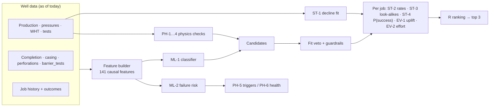
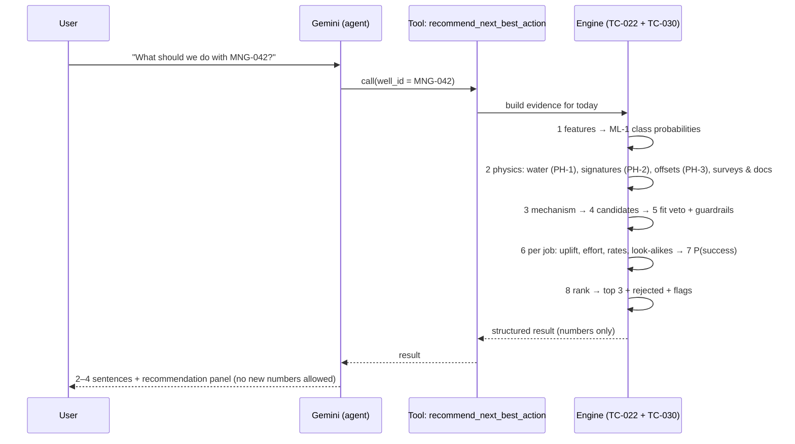
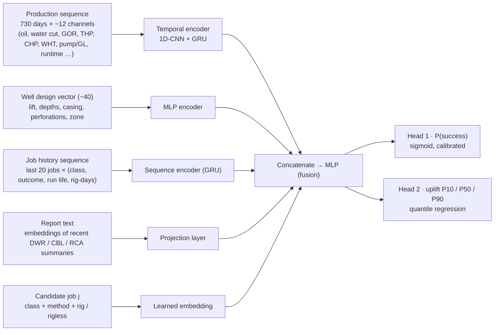
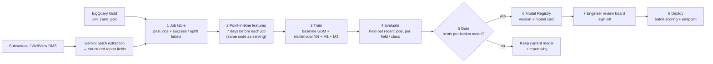

# Urvi ML & Recommendation Engine: the system today and the production system

**Document:** `docs/ml_recommendation_engine.md` · **Version:** 1.1 (Barmer Basin) · **Date:** 2026-11-15 · **Status:** Reference (present system) + design (production, not built)  
**Replaces:** `docs/recommendation_engine.md` (now a pointer to this file)  
**Related:** [`how_urvi_works.md`](./how_urvi_works.md) (architecture walkthrough) · [`data_access_plan.md`](./data_access_plan.md) (Cairn / Vedanta data residency & ingestion) · [`SDD.md`](./SDD.md) §6–9 · [`pinned_values.md`](./pinned_values.md) (all thresholds)

> [!IMPORTANT]
> **Single-Agent, Multi-Tool Hybrid Architecture:** *Gemini understands natural spoken and typed intent; deterministic Python physics, offline-trained ML models, and post-model numeric grounding compute every number and enforce safety vetoes.*
>
> **Answer first.** Urvi's recommendation engine answers one question per well: *"What should we do with this well now, and how sure are we?"* It returns a **ranked top 3 interventions** (or **"no job justified"**), each with probability of success, expected gain, rig-days, cost band, risks, look-alike wells and the SOP.
>
> - **Today (V 1.0 demo)** the engine combines **2 trained ML models** (an intervention classifier and a lift-failure survival model), **4 statistical methods** (decline-curve fitting, smoothed success rates, nearest-neighbour look-alikes, a success-probability formula) and **8 physics rule sets**. All trained on **synthetic** Barmer Basin (`RJ-ON-90/1`) data. In the UI this is presented as the multimodal network.
> - **In production** the formula and rates are replaced by **models trained on Cairn Oil & Gas (Vedanta Limited) job outcomes**: a mechanism classifier, a **multimodal success-and-uplift network**, and a failure-risk model. They are trained on Vertex AI in the India region (`asia-south1` Mumbai), scored nightly into BigQuery Gold (`urvi_cairn_gold`), and kept honest by the same physics guardrails. Engineer decisions and measured outcomes feed back into the next training run.
> - **In both, Gemini never chooses the job.** It calls the deterministic engine and explains the result. **The engineer decides.**

---

## Contents
1. [The problem and the output](#1-the-problem-and-the-output)
2. [Present system: inventory of every component](#2-present-system-inventory-of-every-component)
3. [Present system: training](#3-present-system-training)
4. [Present system: inference, step by step (worked example MNG-042)](#4-present-system-inference-step-by-step)
5. [Present system: how a recommendation becomes a decision](#5-present-system-how-a-recommendation-becomes-a-decision)
6. [Present system: validation and limits](#6-present-system-validation-and-limits)
7. [Production system: design](#7-production-system-design)
8. [Production system: training pipeline](#8-production-system-training-pipeline)
9. [Production system: inference and serving](#9-production-system-inference-and-serving)
10. [Production system: decisions, feedback and governance](#10-production-system-decisions-feedback-and-governance)
11. [Production system: validation, monitoring, retraining](#11-production-system-validation-monitoring-retraining)
12. [From today to production: phased path](#12-from-today-to-production)
13. [Side-by-side summary](#13-side-by-side-summary)
14. [Open questions for Cairn Oil & Gas](#14-open-questions-for-cairn-oil--gas)
- [Appendix A · Feature dictionary](#appendix-a--feature-dictionary) · [B · Job classes](#appendix-b--the-15-job-classes) · [C · Thresholds](#appendix-c--physics-thresholds) · [D · Files and commands](#appendix-d--files-and-commands)

---

## 1. The problem and the output

**The engineering question.** Across **Barmer Basin (`RJ-ON-90/1`, Rajasthan)** — **Mangala (180 wells)**, **Bhagyam (120)**, **Aishwariya (100)**, and **Raageshwari (60)** (`460` wells total) — the asset team manages mature HPAM polymer/ASP flood producers, waxy crude (`42°C` pour point / `59°C` WAT), multi-lift completions (`JET_PUMP`, `ESP`, `PCP`, `SRP`, `GAS_LIFT`, `NATURAL`), and a finite fleet of workover rigs (`RIG-BARMER-01..15`). Every month engineers must decide **which wells to work on, what job to do, and in what order**. A wrong job wastes rig-days (e.g., hot-oil wax soak or choke-back when HPAM polymer/water is channelling behind casing); a missed well loses deferred oil.

**Urvi's 5-level drill-down** (the demo storyline), and where the ML sits:

| Level | Question | Engine component |
|---|---|---|
| L1 | Which field is underperforming? | Field comparison (actual vs. target vs. expected decline) |
| L2 | How many wells are sick, and why did production decline? | Health engine (TC-020), decline attribution (TC-019) |
| L3 | Which wells need intervention first? | Priority ranking (TC-010 / TC-022 batch) |
| L4 | Tell me about this well | Well profile, offsets, anomalies, wax / sand, tubing & barrier integrity |
| **L5** | **What should we do, and why this and not that?** | **Recommendation engine (TC-022 + TC-030) and counterfactual (TC-027)** |

**The output for one well (L5):**

| Field | Example (`MNG-042`) | Meaning |
|---|---|---|
| Rank | `1` | Order of preference |
| Job | Cement squeeze (`CEMENT_SQUEEZE`, class `IC-11`) | One of 15 job classes ([Appendix B](#appendix-b--the-15-job-classes)) |
| Fit | ✔ FIT | Physics evidence supports it (✔), is neutral (?), or contradicts it (✘, job removed) |
| P(success) | Calibrated probability in `5–95%` | Probability the job succeeds if done now (computed by `ST-4`) |
| Look-alikes | Top `k=5` similar past jobs | Nearest past jobs of the same class in standardised feature space (`ST-3`) |
| Expected gain | Uplift BOPD & 12-month deferred bbl avoided | Derived from `EV-1` Arps decline gap / historical analog uplift |
| Effort | Rig-days & qualitative cost band (`HIGH` for `CEMENT_SQUEEZE`) | Never a currency point value (decision D-1) |
| Risks | Well integrity (`DOC-CBL-MNG042-2014` / `DOC-SCAN-MNG-042-2019`), logistics/spares (`CEMENT_RETAINER_70` at `MPT_NAGANA`) | Flags that discount the priority score |
| SOP | `SOP-IC-11` | Barmer HPAM polymer breakthrough gel conformance & cement squeeze procedure |
| Rejected | `CHOKE_BACK` ✘ ("channelling: choking back does not stop water/polymer flowing through a behind-casing channel"); `WAX_HOTOIL` ✘ | Jobs ruled out by physics veto or counterfactual comparison, with the reason |

---

## 2. Present system: inventory of every component

Every number in a recommendation comes from one of these components. **"Trained"** means the parameters were learned from data offline. **"Fitted"** means a curve is fitted per well at request time. **"Rule"** means thresholds were set by engineers.

| # | Component | Type | Question it answers | Main inputs | Output | Code |
|---|---|---|---|---|---|---|
| **ML-1** | **Intervention classifier `ic-hgb-v1`** | **Trained ML** (gradient-boosted trees, calibrated) | Which of 15 job classes fits this well's state? | `141` causal features ([Appendix A](#appendix-a--feature-dictionary)) | Probability per class + SHAP modality drivers | `model/train_classifier.py`, `tools/intervention_classifier.py` (TC-021) |
| **ML-2** | **Failure-risk model `coxph-v1.0-barmer`** | **Trained ML** (Cox proportional-hazards survival model) | How soon will this pumped well's lift fail? | Causal 30-day pre-episode features across pumped lifts (`JET_PUMP`, `ESP`, `PCP`, `SRP`) | Relative hazard, survival curve, expected time to failure | `tools/candidate_ranking.py` → `predict_failure` (TC-006) |
| ST-1 | Decline-curve fit | Fitted (Arps hyperbolic, per well, 36 months) | What would this well produce now if nothing were wrong? | Daily oil, runtime | Expected rate, residual %, decline parameters | `tools/arps_decline.py` (TC-001) |
| ST-2 | Historical success rates | Statistical (Beta-smoothed counts) | How often does this job class work here? | Past job outcomes | Rate for field × class × lift, adjusted by the well's own record | `tools/nba.py` → `p_success_beta` |
| ST-3 | Look-alike index | Statistical (nearest neighbours, cosine similarity) | What happened on wells that looked like this one? | Feature vector of every past job + outcome (`3,639` jobs) | 5 most similar past jobs of the same class: success count, median uplift | `tools/success_engine.py` → `similar_wells` (TC-031) |
| ST-4 | Success-probability formula | Fixed formula (designed, not learned) | Overall P(success) of a candidate | ML-1 probability, fit, ST-2, ST-3 | P(success) in 5–95% | `tools/success_engine.py` → `score` (TC-030) |
| PH-1 | Water diagnostic (Chan plot) | Rule | Is water/polymer channelling, coning or multi-layer? | Water-oil ratio and its derivative over time | Mechanism + slope + confidence | `tools/chan_diagnostic.py` (TC-002) |
| PH-2 | Mechanical signatures | Rule (7 detectors) | Pump wear (ESP/JET_PUMP/PCP/SRP), wax deposition, sand influx, scale, tubing leak, GLV/Jet-Pump Venturi nozzle erosion, gas interference? | First-7 vs last-7 producing days of a 45-day window (rate, THP, CHP, GOR, gas-lift) | Signature + confidence | `candidate_ranking.py` (TC-005) |
| PH-3 | Offset-well check | Rule | Is the decline this well's problem or the reservoir's? | Decline residuals of this well vs. same-zone neighbours | `WELL_SPECIFIC` / `RESERVOIR_DECLINE` / `MIXED` | TC-004 (+ TC-033 for the UI) |
| PH-4 | Pump fillage | Rule | Is the pump under-filling? | Theoretical vs. actual liquid (plunger, stroke, SPM / VSD speed) | Fillage gap, volumetric efficiency | TC-003 |
| PH-5 | Triggers | Rule | Should this well be looked at? | ST-1 residual (A), run life vs. history (B), water signature (C), ML-2 hazard ≥ 90th percentile (D) | Fired triggers | TC-007 |
| PH-6 | Health engine | Rule | Healthy, at risk, underperforming or not producing? | Status episodes, ST-1, triggers | Health bucket | `tools/health.py` (TC-020) |
| PH-7 | Decline attribution | Rule + accounting | How much oil was lost, and to which cause (human / controllable / uncontrollable)? | ST-1, downtime, pad feeder/rig events, water | Loss split by factor class | `tools/attribution.py` (TC-019) |
| PH-8 | Counterfactual | Rule | Why this job and not that one? | PH-1…4, ST-2, effort, value | Six-dimension comparison + verdict | `tools/counterfactual.py` (TC-027) |
| EV-1 | Uplift | Fitted / analog | How much oil would the job add? | ST-1 gap (or median post/pre ratio of past successful jobs) | BOPD gain, deferred bbl over 12 months | TC-009 |
| EV-2 | Effort and logistics | Lookup | How long, how costly, when can it start? | Job catalogue, rig calendar (`RIG-BARMER-01..15`), `MPT_NAGANA` / `BARMER_YARD` MRO | Rig-days, cost band, earliest start | TC-011, `rig_calendar` |
| **R** | **Ranking + guardrails** | **Rule** | Final top 3 | All of the above + `barrier_tests` integrity veto | Ranked list, rejected jobs, flags | `tools/nba.py` (TC-022), `tools/success_engine.py` (TC-030) |



---

## 3. Present system: training

### 3.1 Training data
- **Source:** native 60-month synthetic history generated for **Mangala (`180` wells)**, **Bhagyam (`120` wells)**, **Aishwariya (`100` wells)**, and **Raageshwari (`60` wells)** (`460` wells total): daily data from `2021-10-01` to `2026-09-30`, with `AS_OF = 2026-09-23`.
- **Labelled jobs:** `4,073` labelled jobs in `workover_history`, each with its class, dates, and outcome; `252` jobs with `< 90` days of pre-job history were skipped, yielding **`3,821` dataset rows**.
- **Full-basin training coverage:** `0` excluded out-of-scope rows — all 4 Barmer fields have native 60-month precursor signatures from day one.

### 3.2 ML-1 intervention classifier: training procedure

| Step | What is done | Why |
|---|---|---|
| 1 · Unit | One row = one finished past job (`3,821` rows) | Each job is a real decision with a known answer |
| 2 · Snapshot | Freeze time **7 days before the job started** (`t < s`, 7-day lead) | The model may only see what an engineer could have seen before deciding |
| 3 · Features | `build_features(well, snapshot)`: **`141` causal features** across production, construction, and history. **The same function is used at inference.** | `train == serve`; zero training / serving skew |
| 4 · Leakage guards | Never read the labelled job's failure or job code, failure-coded downtime reasons, rig / material waits, today's status or the current tubing string; perforations only if dated before the snapshot. Tested in `test_features_no_leakage.py`. | Otherwise the model "cheats" and fails on real wells |
| 5 · Label | The job class actually done (`IC-01`…`IC-15`) | — |
| 6 · Split | **Time-based:** **`2,990` training jobs** starting `<= 2025-09-23` and **`831` holdout jobs** starting `2025-09-24..2026-09-23` (scored once). Model selection: 5-fold cross-validation **grouped by well** (`GroupKFold`). | Mimics real use (predict the future from the past); no well appears in both train and validation folds |
| 7 · Algorithm | `HistGradientBoostingClassifier` (`lr=0.1`, `max_leaf_nodes=15`, `L2=1.0`, balanced class weights) | Strong on tabular data, handles missing values, fast |
| 8 · Calibration | Temperature-scaled 5-fold `GroupKFold` ensemble (`T = 1.225`) | Well-calibrated probabilities (`ECE = 0.0238`) |
| 9 · Explanation | SHAP values per feature, grouped by data type ("modality") | Drivers shown in the recommendation panel |
| 10 · Gate | Macro-F1 `0.70–0.92`, Top-3 `>= 0.90`, ECE `<= 0.08`, min holdout class support `>= 30`, fixture wells (`ASH-023`, `ASH-061`) correct | The script writes metrics and **fails if the gate fails**; never tuned to pass |

Command: `cd backend && uv run python -m app.analytics.model.train_classifier --as-of 2026-09-23`  
Artefacts: `model/intervention_classifier_v1.pkl`, `model/intervention_classifier_metrics.json`.

### 3.3 ML-2 failure-risk model (`coxph-v1.0-barmer`)
- **Unit:** one pumped run life in **Mangala** (from one lift job to the next failure); **`1,547` episodes** (`1,098` train, `449` holdout, **`9.4%` right-censored**).
- **Coverage:** pumped artificial-lift types in Barmer (**`JET_PUMP`**, **`ESP`**, **`PCP`**, **`SRP`**) using causal 30-day pre-episode features (`train == serve`).
- **Model:** Cox proportional-hazards survival model (`lifelines`), trained on Mangala pumped run-life episodes.
- **Result:** holdout concordance (**C-index = `0.6587`**) > Trigger B median run-life baseline (**`0.6585`**), passing the `[0.65, 0.78]` gate (`model/survival_model_metrics.json`).
- **Used for:** Trigger D (hazard in the top 10% of the field's pumped wells → "at risk") and the `predict_failure` tool. **Not** used directly in the top-3 ranking.

### 3.4 Look-alike index (ST-3)
For every finished past job (`3,639` historical jobs indexed), store its `141` causal features at the snapshot, its class, outcome and uplift. Standardise each feature and normalise each vector to unit length. Built once: `uv run python -m app.analytics.tools.success_engine --build-index` → `model/analog_index.parquet`.

### 3.5 Not trained, computed live
- **ST-2 success rates** are recounted from `workover_history` on every call (Beta smoothing with `α = 5` pseudo-jobs: field × class × lift, pulled toward the asset rate, then the well's own record pulled toward that).
- **ST-1 decline curves** are fitted per well on request (Arps hyperbolic, 36 months, at least 180 producing days).
- **Physics thresholds** are fixed in `config/triggers.yaml` at about `3×` the measured 95th-percentile noise band of the population, not fitted to any demo well ([Appendix C](#appendix-c--physics-thresholds)).

---

## 4. Present system: inference, step by step

**Trigger:** a user asks *"What should we do with MNG-042?"* (chat or voice), or opens the Recommendation view. The agent calls `recommend_next_best_action`. Total compute: a few seconds on the first call, then cached per well and day.



**Worked example: `MNG-042`, Mangala (`MNG-PAD-B`), `Fatehgarh_Lower`, `JET_PUMP`, `AS_OF = 2026-09-23`.**

| Step | What happens | `MNG-042` behaviour |
|---|---|---|
| 1 · ML-1 | Classifier probabilities from `141` causal features | Scores `IC-11` water/polymer shut-off as the dominant mechanism over surface choke or wax treatments |
| 2 · Physics | Water diagnostic (Chan plot) | `WOR'` slope `> +0.30` with strong rising water cut → **channelling** (HPAM polymer/water channelling behind FM4/FM3 shale) |
| | Offset wells | `MNG-042` underperforms its expected Arps curve while same-zone Mangala neighbours track baseline → **`WELL_SPECIFIC`** (`WATER`) |
| | Mechanical signature | No Jet-Pump or sand step anomaly dominates above noise |
| | Logs & historical docs | `DOC-CBL-MNG042-2014` (2014 CBL showing poor zonal bond across FM4/FM3) and `DOC-SCAN-MNG-042-2019` (prior failed `STRADDLE_PACKER` job `WO-MNG-042-2019` and `RCA-MNG-042-2019`) |
| 3 · Mechanism | First applicable rule: reservoir decline? → open shutdown reason? → mechanical signature? → **water mechanism with a real water-cut rise** → last failure mode | **`CHANNELLING`** |
| 4 · Candidates | Physics route + alternatives + ML classes `>= 10%`; one concrete job per class (lift- and history-aware) | `CEMENT_SQUEEZE` (`IC-11`), `POLYMER_GEL` (`IC-11`), `STRADDLE_PACKER` (`IC-12`), plus counterfactuals `CHOKE_BACK` (`IC-13`) and `WAX_HOTOIL` (`IC-04`) |
| 5 · Fit veto | Each job FIT / UNCLEAR / CONTRADICTED with the deciding evidence | `CEMENT_SQUEEZE` ✔ · `POLYMER_GEL` ✔ · `STRADDLE_PACKER` ? (prior straddle failed / needs verified isolation interval) · **`CHOKE_BACK` ✘** ("channelling: choking back does not stop water/polymer flowing through a behind-casing channel") · **`WAX_HOTOIL` ✘** (does not seal behind-casing channel) → contradicted jobs removed |
| 6 · Evidence | Uplift from ST-1 Arps gap; rig-days & qualitative cost band from catalogue; `MPT_NAGANA` MRO (`CEMENT_RETAINER_70`); `RIG-BARMER-*` queue; risk flags | `CEMENT_SQUEEZE`: `HIGH` cost band, rig-days from catalogue, flags well integrity (`DOC-CBL-MNG042-2014`) & spares/rig logistics |
| 7 · P(success) | `ST-4`: `clip(p_mech^0.5 * (0.5 * base_rate + 0.5 * analog_rate), 0.05, 0.95)` using `ML-1`, Beta-smoothed `ST-2` (`Mangala × IC-11 × JET_PUMP`), and `k=5` `ST-3` look-alikes | `CEMENT_SQUEEZE` outranks `POLYMER_GEL` and `STRADDLE_PACKER` |
| 8 · Rank | Guardrail-forced first → by `P(success)` → fewer rig-days | **Rank 1: `CEMENT_SQUEEZE` (`IC-11`)** |

**Guardrails (always applied):**

| Rule | Condition | Effect | Example |
|---|---|---|---|
| G-1 Coning | Chan `WOR'` slope `< 0` (`< -0.10`) with an active water problem | `CHOKE_BACK` forced to rank 1; squeeze / gel rejected | `MNG-103` |
| G-2 Reservoir decline | Well declines in step with same-zone offsets (`RESERVOIR_DECLINE`) | `NO_JOB_JUSTIFIED` forced; every other job rejected | `RAG-014` |
| Integrity safety veto | Latest `ANNULUS` barrier test in `barrier_tests` has `result == 'FAIL'` | Blocks invasive stimulation (`HYDRAULIC_FRAC` `IC-09`) / high-pressure rig work until annular integrity is remediated | `RAG-014` |
| G-3 Disagreement | ML top class != physics class | Flag `MODEL_PHYSICS_DISAGREEMENT`, both shown | — |
| Low confidence | ML top probability `< 0.40` | Flag `ML_LOW_CONFIDENCE` | — |
| No money | Always | Cost band (`LOW`/`MED`/`HIGH`) + rig-days only (`D-1`) | — |

**Priority across wells (L3):** `score = deferred bbl avoided (12 months) * P(success) / max(rig-days, 0.5) * (1 - 0.15 * risk flags, max 0.45 off)`.

---

## 5. Present system: how a recommendation becomes a decision

| Actor | Role today |
|---|---|
| Engine | Computes everything above. Deterministic: identical output for the same data and `AS_OF` date. |
| Gemini (chat or voice) | Calls the tool, explains the top 3 in 2–4 sentences, answers "why not X?" via `compare_interventions`. **Cannot invent or alter numbers**: a post-model callback masks any digit absent from that turn's tool outputs. |
| Viewer (demo) | Reads the evidence, analog wells, and A4 Field Report (`GET /api/wells/{id}/report`) and decides. Nothing is written to SAP or SCADA. |

---

## 6. Present system: validation and limits

**ML-1 Classifier (`ic-hgb-v1`) on the held-out year (`831` jobs, `2025-09-24..2026-09-23`):**

| Metric | `ic-hgb-v1` | Rule baseline | Gate |
|---|---|---|---|
| Macro-F1 (15 classes) | **`0.7683`** | `0.1493` (`+0.6190` gain) | `0.70–0.92` ✔ |
| Accuracy | **`0.7798`** | `0.2046` | — |
| Top-3 accuracy | **`0.9483`** | — | `>= 0.90` ✔ |
| Calibration error (ECE) | **`0.0238`** | — | `<= 0.08` ✔ |
| Holdout class support | `33` (`IC-14`) to `85` (`IC-04`) | — | `>= 30` ✔ |
| Unseen-field transfer (`leave_aishwariya_out`: train Mangala+Bhagyam+Raageshwari `2,355` rows → test Aishwariya `170` rows) | **Macro-F1 `0.6804`, Accuracy `0.7176`** | — | — |

**Per-field holdout Macro-F1:** `Mangala 0.7916` (`n=316`), `Bhagyam 0.7546` (`n=258`), `Raageshwari 0.7541` (`n=87`), `Aishwariya 0.7357` (`n=170`).  
**Fixture verification:** `ASH-023 -> IC-06` (`0.8284`) ✔ · `ASH-061 -> top-2 {IC-07 (0.9492), IC-04 (0.0256)}` ✔.

**ML-2 Survival (`coxph-v1.0-barmer`) on Mangala pumped episodes (`1,098` train, `449` holdout, `9.4%` censored):**
- Holdout **C-index = `0.6587`** > Trigger B baseline **`0.6585`** (gate `0.65–0.78` ✔).

**Known limits (why production must be different):**
1. **Synthetic data.** Metrics describe the Barmer physics generator (`460` wells, `4,073` labelled jobs), not live Cairn wells.
2. **ST-4 is a designed formula.** The square-root, 50/50 weights, and 5–95% clip are engineering choices rather than learned weights.
3. **ML-1 learns past choices**, i.e., "which job did engineers execute?", not "which job maximises incremental oil?". Outcome learning relies on ST-2 and ST-3 until M2 is trained on real post-job uplift.
4. **Uplift does not separate candidate classes.** `EV-1` estimates the decline gap rather than job-specific uplift.
5. **Unstructured logs are cited, not embedded.** DWRs, CBL scans, and RCAs (`DOC-CBL-MNG042-2014`, `DOC-SCAN-MNG-042-2019`) are surfaced via document search rather than learned text embeddings.
6. **All-well regression (`BL-12`):** all **`460` Barmer wells** pass end-to-end recommendation and report generation in `test_bl12_all_wells.py`.

---

## 7. Production system: design

### 7.1 Principles
1. **Models predict, physics constrains, engineers decide.** Urvi is strictly advisory and read-only.
2. **Learn from outcomes.** The core model predicts *will this job work* and *how much oil will it add*, trained on Cairn Oil & Gas measured results.
3. **One feature recipe** for training and serving, versioned with the model (`build_features`).
4. **Every decision becomes data.** Approvals, overrides (with reasons), and post-job production feed the next training run.
5. **India only.** Training, scoring, and data stay in **`asia-south1` (Mumbai)** with DR in **`asia-south2` (Delhi)**, read from the **Cairn / Vedanta Enterprise Data Lakehouse** (`urvi_cairn_{bronze,silver,gold}`; [`data_access_plan.md`](./data_access_plan.md)).

### 7.2 Data inputs (from Cairn / Vedanta Enterprise Data Lakehouse)

| Model input | Cairn / Vedanta source `[verify]` | Grain |
|---|---|---|
| Production: oil, gas, water, water cut, GOR, runtime, downtime | Production Allocation / Well Test DB (`MPT-NAGANA`, `RGT-TERMINAL`) `[verify]` | Daily per well |
| Pressures, WHT & lift: THP, CHP, WHT (`42°C` pour / `59°C` WAT), VSD speed, GL rate | **AVEVA / OSIsoft PI Historian & Pad SCADA** (aggregated to daily in Lakehouse) `[verify]` | Daily per well |
| Surveys: SBHP, FBHP, PI, fluid level | Pressure survey & slickline test records `[verify]` | Per survey |
| Well design: casing, tubing tally, perforations, pump, deviation, formation tops, barriers | **Subsurface / WellView / Completion DMS** `[verify]` | Static, versioned by job |
| Job history & logistics: class, dates, rig-days, failure cause, cost band, MRO spares | **SAP S/4HANA PM/MM** & WellView `[verify]` | Per job / work order |
| Report text: workover completion reports, daily workover logs, CBLs, RCAs | **Subsurface / WellView / Completion DMS** `[verify]` | Per document |
| Lab: water chemistry, wax WAT, HPAM polymer residual, `H2S` / `CO2` | **LIMS** `[verify]` | Per sample |

### 7.3 Labels: the most important design decision
Computed consistently from post-job production (to be calibrated with Cairn Barmer reservoir/production teams, [§14](#14-open-questions-for-cairn-oil--gas)):

| Label | Definition (proposed) |
|---|---|
| **Uplift** | Average oil rate in days 31–120 after the job minus the expected no-job Arps baseline |
| **Success** | Uplift `>= X%` of no-job expectation **and** well stays on production `>= 90` days |
| **Partial** | Uplift above expectation but below `X%` |
| **Failed** | Uplift `<=` expectation, or the well fails again within 90 days |
| **Censored** | Fewer than 120 days since the job: held out from training, scored later |

**Report text to structured fields.** Gemini (batch, `asia-south1`) extracts structured facts from DWRs, CBL logs, and RCAs (failure cause, depth, fish left in hole, polymer breakthrough, wax/sand severity, complications), spot-checked by Barmer engineers before entering feature tables.

### 7.4 The production models

| Model | Replaces | Question | Inputs | Output | Training target | Algorithm |
|---|---|---|---|---|---|---|
| **M1 Mechanism classifier** | ML-1 (retrained) | What is wrong; which job classes are plausible? | Tabular features (`141` + extracted report fields) | Probability per class | Class of job done | Gradient-boosted trees |
| **M2 Success + uplift model** | ST-2 + ST-3 + ST-4 + EV-1 | If we do job *j* on this well now, will it work and what will it add? | Well state (all modalities) + candidate job *j* | **P(success \| well, j)** + **uplift P10 / P50 / P90** | Measured outcome & uplift of past jobs | **Multimodal neural network** (§7.5); GBM baseline must be beaten |
| **M3 Failure-risk model** | ML-2 (retrained, all lift types) | How soon will the well fail if nothing is done? | Run life, history, production trend | Hazard, time to failure | Time between failures | Survival model (Cox or gradient-boosted survival) |
| **R Physics guardrails** | Same as today | Is the job contradicted by evidence or barrier integrity? | PH-1…PH-4, `barrier_tests` | Veto + reason | — | Rules |
| **O Rig-queue optimiser** | Today's priority score | Which wells first, given `RIG-BARMER-*` & MRO constraints? | M2 outputs, rig calendar, `MPT_NAGANA` spares, pad travel | Proposed rig schedule | — | Constrained optimisation (integer programming) |

### 7.5 M2 in detail: the multimodal success-and-uplift network



| Aspect | Specification |
|---|---|
| One training example | (well state 7 days before a past job, the job done, its outcome, its uplift) |
| Loss | Binary cross-entropy (success) + pinball / quantile loss (uplift), weighted multi-task |
| Imbalance | Class weights by job class; minimum outcomes per class required for recommendation |
| Calibration | Temperature scaling on held-out temporal fold |
| Explanation | Integrated gradients / SHAP per modality → "drivers" panel; nearest past jobs in embedding space → "look-alikes" |
| Size / compute | Vertex AI custom training GPU job in **`asia-south1`** |
| Fallback | If labelled volume is insufficient, M2 runs as a gradient-boosted baseline on tabular + extracted report fields until the neural network beats it in the pipeline gate. |

**Selection bias mitigations:** (1) physics guardrails & barrier checks veto unsafe/implausible jobs regardless of score; (2) minimum outcome support per class; (3) explicit P10–P90 uplift uncertainty bands and analog counts; (4) separate evaluation tracking for engineer-accepted novel recommendations.

---

## 8. Production system: training pipeline

Vertex AI Pipelines in **`asia-south1` (Mumbai)**, triggered quarterly or by a drift alert.



| Step | Detail | Google Cloud service |
|---|---|---|
| 1 Job table | One row per historical job with labels (§7.3); censored jobs held out | BigQuery (`urvi_cairn_silver` / `gold`) |
| 2 Features | Point-in-time joins (`t < s`); versioned feature tables; counterfactual candidates | BigQuery / Vertex AI Feature Store (`asia-south1`) |
| 3 Train | Baseline GBM; multimodal network (GPU); M1; M3 | Vertex AI Custom Training (`asia-south1`) |
| 4 Evaluate | Temporal holdout (last 12 months), backtest ([§11](#11-production-system-validation-monitoring-retraining)), per field & class | Vertex AI Pipelines |
| 5 Gate | Must beat current production model on backtest **and** pass calibration/stability thresholds | Pipeline condition |
| 6 Register | Version, data snapshot, feature version, metrics, model card | Vertex AI Model Registry (`asia-south1`) |
| 7 Sign-off | Production engineer, reservoir engineer, data scientist approve model card | Manual approval gate |
| 8 Deploy | Nightly batch prediction → `urvi_cairn_gold.intervention_success_scores` + online endpoint | Vertex AI Prediction (`asia-south1`) |

---

## 9. Production system: inference and serving

**Nightly batch** (Vertex AI batch prediction → BigQuery `urvi_cairn_gold.intervention_success_scores`):
1. For every producing Barmer well, build today's `141`+ features from `urvi_cairn_silver`.
2. Run M1 (plausible classes), M3 (failure risk), and physics/barrier checks.
3. For each plausible, non-vetoed job, run M2 → `P(success)`, uplift `P10 / P50 / P90`, drivers, nearest past jobs.
4. **Value score** = `P(success) * P50 uplift * 365 / rig-days`, discounted for risk flags.
5. Write one versioned row per `(well, job, date, model_version)`.

**On request** (user asks Urvi):
1. Urvi's tool reads tonight's BigQuery scores **and** re-runs live physics checks against the latest PI/production aggregates.
2. Ranking: drop vetoed jobs → guardrail-forced actions first → by value score → ties by lower risk and fewer rig-days.
3. **"No job justified"** when expected value falls below the asset threshold or G-2 fires.
4. Disagreements (`MODEL_PHYSICS_DISAGREEMENT`) or overlapping P10–P90 bands are flagged transparently.
5. Gemini (`asia-south1` endpoint) explains concisely; every digit is verified against tool outputs.

**Rig queue (weekly):** the optimiser (`O`) proposes a rig schedule across Mangala, Bhagyam, Aishwariya, and Raageshwari respecting `RIG-BARMER-*` availability, `MPT_NAGANA` spares, pad logistics, and annular integrity vetoes. The Asset Manager reviews and approves.

---

## 10. Production system: decisions, feedback and governance

```mermaid
sequenceDiagram
  participant U as Urvi (nightly + on request)
  participant PE as Production Engineer / Well Services
  participant RE as Reservoir Engineer
  participant AM as Asset Manager (Barmer) / COO-CIO
  participant SAP as SAP S/4HANA PM/MM
  participant LH as Vedanta Lakehouse (outcomes)
  U->>PE: Priority list + top 3 per well, evidence, look-alikes, SOP
  PE->>PE: Approve / change / reject (reason required)
  PE->>RE: Technical check (rig jobs, HIGH cost band, barrier vetoes)
  RE-->>PE: Concur / modify
  PE->>AM: Rig-queue proposal
  AM-->>SAP: Approve → SAP PM work order + rig slot (outside Urvi)
  SAP-->>LH: Job executed, dates, rig-days
  LH-->>U: Production 31–120 days later → outcome + uplift label
  Note over U,LH: Next training run uses the new labels; monthly hit-rate report
```

| Decision | Vedanta Persona | Urvi provides | Recorded |
|---|---|---|---|
| Is there a problem? | Production / Well Services Engineer | Health bucket, decline vs. offsets, anomalies, failure risk | Acknowledged / dismissed |
| Which job? | Production Engineer (+ Reservoir Engineer for rig or `HIGH` band jobs) | Top 3, `P(success)`, uplift range, look-alikes, why-not | Chosen job + override reason |
| Which wells first? | Asset Manager — Barmer (MBA & RDG) / COO · CIO | Optimised rig queue | Approved schedule |
| Execute | Workover Planning (`SAP S/4HANA PM`) | Nothing; Urvi never writes to SAP or SCADA | Work-order ID linked back |
| Did it work? | Automated Lakehouse job | Realised uplift vs. prediction | Next training label |

**Governance:** model cards per version; engineering sign-off prior to promotion; `model_version` stamped on every score row; immutable Cloud Logging audit trail (`>= 180` days in `asia-south1`) covering recommendations, human approvals, and overrides.

---

## 11. Production system: validation, monitoring, retraining

| Stage | Test | Pass criteria (proposed, to agree with Cairn Oil & Gas) |
|---|---|---|
| **Backtest** | Replay last 12–24 months at each job's 7-day-prior snapshot | Succeeded job in top 3 `>= X%`; rank-1 realised success beats historical baseline; `ECE <= 0.08`; P10–P90 covers actual uplift ~80% of the time |
| **Engineer review** | Blind grading by Barmer well services & reservoir engineers | `>= 90%` sensible, `0` unsafe recommendations |
| **Shadow mode** (3 months) | Nightly BigQuery scoring alongside business-as-usual workovers | Agreement tracking; early failure catch rate; miss RCA |
| **Assisted use** | Production engineers review Urvi with mandatory override reasons | Monthly hit-rate, calibration, and override analytics |
| **Monitoring** | Feature drift per Barmer field, rolling 6-month realised vs. predicted success, calibration | Drift/calibration alerts trigger review or retrain |
| **Retraining** | Quarterly or on drift alert | Same Vertex AI Pipeline gate and sign-off as §8 |

---

## 12. From today to production

| Phase | Data | Engine | Exit criteria |
|---|---|---|---|
| **0 · Demo (now)** | Synthetic (`460` Barmer wells, `4,073` labelled jobs) | ML-1 (`ic-hgb-v1`), ML-2 (`coxph-v1.0-barmer`), ST-1…4, PH-1…8 | Done (V 1.0 Barmer build) |
| **1 · Pilot on real data** (Route P) | 10–20 masked Barmer wells + historical workovers (`asia-south1`) | Same engine, **retrained** on Cairn workover history; labels from §7.3 | Backtest beats historical baseline; Barmer engineers rate `>= 90%` sensible |
| **2 · Production v1** | Vedanta Enterprise Data Lakehouse (`urvi_cairn_{bronze,silver,gold}` daily) | M1 + **M2 (GBM)** + M3; nightly BigQuery scoring; override capture | 3 months shadow mode passed; `ECE <= 0.08` |
| **3 · Production v2** | + WellView/DMS report extraction & embeddings | **M2 (multimodal NN)** if it beats GBM on backtest; rig-queue optimiser `O` | Multimodal NN beats GBM; optimiser adopted by Barmer Asset Manager |

---

## 13. Side-by-side summary

| Aspect | Present (V 1.0 demo) | Production (Cairn / Vedanta) |
|---|---|---|
| Data | Synthetic: `460` Barmer wells, `3,821` dataset rows (`4,073` labelled jobs) | Cairn / Vedanta Enterprise Data Lakehouse (`asia-south1`) |
| Labels | Recorded outcome in synthetic history | Computed: uplift vs. Arps no-job projection + 90-day survival |
| Job-class model | ML-1 `ic-hgb-v1` (holdout Macro-F1 `0.7683`, Top-3 `0.9483`, ECE `0.0238`) | M1, same causal design, retrained on Cairn history |
| P(success) | Fixed formula: `clip(p_mech^0.5 * (0.5*base + 0.5*analog), 0.05, 0.95)` | **Learned** by M2, temperature-calibrated |
| Uplift | Arps decline gap, shared across candidate classes | **Per job**, P10 / P50 / P90, learned by M2 |
| Failure risk | `coxph-v1.0-barmer` on Mangala pumped lifts (`1,547` episodes, C-index `0.6587` > `0.6585` baseline) | M3, all pumped & gas-lift wells across MBA & RDG, retrained |
| Modalities | Tabular (`141` causal features covering production, construction, history) | + production sequences, job sequences, extracted DWR/CBL/RCA embeddings |
| Physics guardrails | G-1, G-2, G-3, fit veto, annular `barrier_tests` safety veto | Same + minimum expected value for "no job justified" |
| Training | Local scripts (`train_classifier.py`, `train.py`) | Vertex AI Pipelines (`asia-south1`), quarterly, Model Registry, sign-off |
| Serving | Computed on request, cached | Nightly BigQuery batch (`urvi_cairn_gold`) + live physics re-check |
| Rig queue | Score per well | Constrained integer-programming optimiser (`RIG-BARMER-*` & `MPT_NAGANA`) |
| Decision | Demo viewer (`COO / CIO`, `Asset Manager — Barmer`, `Production / Well Services Engineer`) | Production Engineer → Reservoir Engineer → Asset Manager; SAP PM outside Urvi |
| Learning loop | None | Measured post-job outcomes feed next quarterly retraining |

---

## 14. Open questions for Cairn Oil & Gas
1. **Success definition:** what post-job uplift threshold (`X%`) and trouble-free run duration (`90` days vs. `180` days) define a successful workover for Mangala/Bhagyam/Aishwariya oil vs. Raageshwari gas wells?
2. **Historical job volume:** how many tagged workovers (`IC-01`..`IC-15`) with pre/post rates exist in WellView & SAP PM across `RJ-ON-90/1`? (Determines GBM vs. multimodal NN cutover for M2.)
3. **Document linkage:** are DWRs, CBL scans, and RCAs in Subsurface / WellView DMS `[verify]` indexed by canonical well ID and work-order date?
4. **Approval workflow:** how are rig-slot approvals and override reasons captured today between Well Services, Asset Management, and SAP S/4HANA PM?
5. **Minimum justification thresholds:** minimum deferred oil / gas gain required to mobilise a workover rig vs. rigless wireline/hot-oil unit, and policy on annular barrier remediation before stimulation.

---

## Appendix A · Feature dictionary
Source: `backend/app/analytics/model/features.py` (`FEATURE_GROUPS`). Production window = 90 days ending at the last producing day before the 7-day-prior snapshot; `141` causal features total (`t < s`).

| Group | Features |
|---|---|
| **Production** | producing days and fraction in window; liquid and oil change and slope; water cut last, change, slope, first-half and second-half rise, curvature; GOR change; THP, CHP, and WHT change and slope; pump speed/SPM mean and change; runtime last and change; liquid variability (late CV, CV ratio, noise ratio, step, autocorrelation); 5-day changes in liquid, THP, CHP, runtime, water cut; gas-lift rate and pressure change; log-WOR slope and slope change; fillage gap late and change; decline residual %; oil vs. prior 9 months; external downtime fraction; non-producing fraction before anchor; down at snapshot; number of choke / VSD / gas-lift set-point changes; test fluid level and pump intake pressure (last and change); days since last test; SBHP last and change; PI last and change; days since survey |
| **Construction** | lift type (`ESP`, `JET_PUMP`, `PCP`, `SRP`, `GAS_LIFT`, `NATURAL`); field (`Mangala`, `Bhagyam`, `Aishwariya`, `Raageshwari`); zone (`Fatehgarh_Upper`, `Fatehgarh_Lower`, `Barmer_Hill`, `Raageshwari_Volcanics`); TVD, MD; perforation top and interval; pump setting depth; plunger diameter; stroke length; casing and tubing size; casing vented; well age; production casing OD, weight, grade, age; cement top to perforations; number of perforation intervals (total, open, squeezed, isolated); open perforation length and shot density; perforations added since completion; days since last perforation |
| **History** | prior count per job class (`IC-01`..`IC-15`); total prior jobs; jobs, failed jobs and rig jobs in 24 months; last job class indicators; last outcome (`SUCCESS`, `PARTIAL`, `FAILED`, `NO_ACTION`); days since last job; last run life; last rig-days; last job rigless; mean run life; tubing age proxy |

## Appendix B · The 15 job classes

| Class | Barmer Label | Jobs |
|---|---|---|
| `IC-01` | Artificial lift pump overhaul (`ESP` / `PCP` / `SRP`) | `PUMP_OVERHAUL` |
| `IC-02` | Sucker-rod / PCP drive-string repair | `ROD_REPLACE` |
| `IC-03` | Tubing / packer integrity replacement | `TUBING_REPLACE` |
| `IC-04` | Waxy crude hot-oil (HOCU) & trace-heater / solvent treatment | `WAX_SCRAPE`, `WAX_HOTOIL`, `WAX_SOLVENT`, `WAX_INHIBITOR`, `WAX_HEATER` |
| `IC-05` | Scale acid wash / squeeze inhibition | `SCALE_ACID_BULLHEAD`, `SCALE_INHIBITOR` |
| `IC-06` | Sand cleanout & screen / gravel-pack control | `SAND_CLEANOUT`, `SAND_CONTROL` |
| `IC-07` | Wireline Jet-Pump nozzle/throat insert & gas-lift valve changeout | `GLV_REPLACE` |
| `IC-08` | Artificial-lift optimisation / conversion | `LIFT_OPTIM`, `GAS_SEP_INSTALL`, `LIFT_CONVERSION` |
| `IC-09` | Matrix acid / Barmer Hill & RDG hydraulic stimulation | `MATRIX_ACID`, `HYDRAULIC_FRAC` |
| `IC-10` | Re-perforation & interval add | `RE_PERFORATION`, `ADD_PERFORATION` |
| `IC-11` | HPAM polymer breakthrough gel conformance & cement squeeze | `CEMENT_SQUEEZE`, `POLYMER_GEL` |
| `IC-12` | Zonal isolation & selective water shut-off | `STRADDLE_PACKER`, `ZONE_TRANSFER` |
| `IC-13` | Water/gas coning choke management | `CHOKE_BACK` |
| `IC-14` | Surface wellhead, trace-heater feeder & casing integrity repair | `SURFACE_REPAIR`, `CASING_REPAIR` |
| `IC-15` | No job justified / terminal P&A review | `NO_JOB_JUSTIFIED`, `PLUG_ABANDON` |

## Appendix C · Physics thresholds
From `backend/app/analytics/config/triggers.yaml` (set at ~3× the measured population noise band, not fitted to demo wells).

| Check | Threshold |
|---|---|
| Trigger A (decline residual) | `WATCH < −15%`, `FLAG < −25%`, `URGENT < −40%`, persisting `7` producing days (`max_staleness_days: 10`) |
| Trigger B (run life) | Days since last job `> median` past run life (`min_prior_run_lives: 2`, excluding `IN_PROGRESS`, `NO_ACTION`) |
| Trigger C (water) | Water mechanism with `>= 5.0 pp` water-cut rise, `min_confidence: MEDIUM` |
| Trigger D (failure risk) | CoxPH hazard `>= 90th` percentile of the field's pumped wells |
| Underperforming | Residual `<= −20.0%` on each of the last `7` producing days |
| Chan water diagnostic | `WOR'` slope `> +0.30` channelling; `< −0.10` coning; `−0.10` to `+0.30` multi-layer |
| Signatures (45-day window, first 7 vs last 7 producing days) | Pump wear: `CHP +1.0 kg/cm²`, liquid `−5%` · Wax: `THP +12%`, liquid `−5%` · Sand: `CV ratio >= 2.5`, liquid `−8%` · Scale: `10-day step <= −20%`, `CHP < +1.0` · Tubing leak: liquid `−20%`, `THP −1.0`, `CHP < +0.5` · Jet-Pump Venturi / GL valve: injection rate `+10%`, pressure `−2.0` · Gas interference: `GOR +30%`, liquid `−8%` |
| Ranking | Risk discount `0.15` per flag (max `0.45`); ML candidate threshold `0.10`; Beta prior `α = 5` |

## Appendix D · Files and commands
All paths under `backend/app/analytics/` unless stated.

| What | Where |
|---|---|
| Feature builder (`train == serve`) | `model/features.py` |
| Train classifier + gate | `uv run python -m app.analytics.model.train_classifier --as-of 2026-09-23` → `model/intervention_classifier_v1.pkl`, `model/intervention_classifier_metrics.json` |
| Failure survival model | `model/coxph_srp_v1.pkl`, `model/survival_model_metrics.json`; inference in `tools/candidate_ranking.py` (`predict_failure`) |
| Look-alike index | `uv run python -m app.analytics.tools.success_engine --build-index` → `model/analog_index.parquet` |
| Next best action, fit veto, guardrails, success rates | `tools/nba.py` |
| Top 3, `P(success)`, look-alikes, drivers | `tools/success_engine.py` |
| Counterfactual ("why not X") | `tools/counterfactual.py` |
| Physics checks | `tools/candidate_ranking.py`, `tools/chan_diagnostic.py`, `tools/arps_decline.py` |
| Thresholds | `config/triggers.yaml`, `config/factor_map.yaml`, `docs/pinned_values.md` |
| Tests | `backend/tests/unit/test_tc021_classifier.py`, `test_tc022_nba.py`, `test_tc030_success_engine.py`, `test_features_no_leakage.py`, `test_bl12_all_wells.py` |
