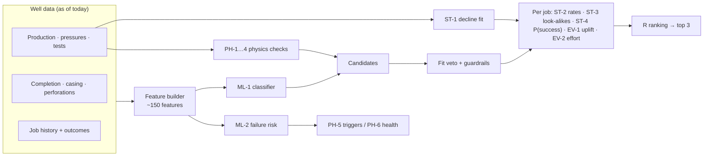
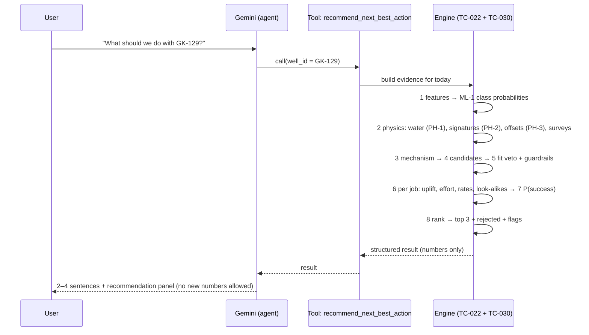
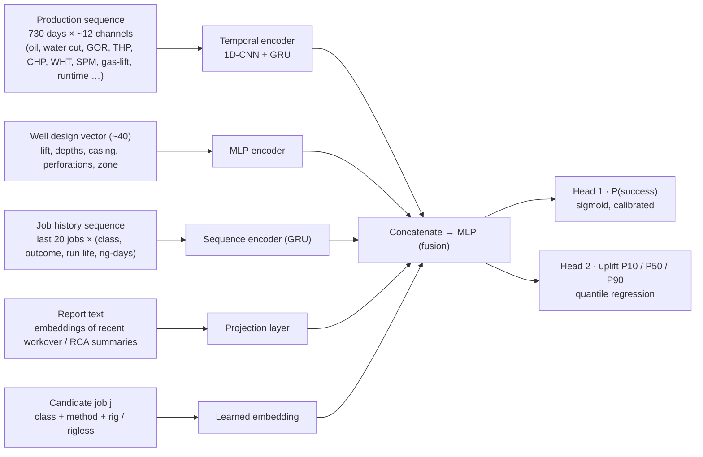
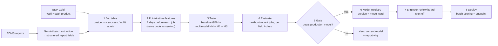

# Urvi ML & Recommendation Engine: the system today and the production system

**Document:** `docs/ml_recommendation_engine.md` · **Version:** 1.0 · **Date:** 2026-11-15 · **Status:** Reference (present system) + design (production, not built)  
**Replaces:** `docs/recommendation_engine.md` (now a pointer to this file)  
**Related:** [`how_urvi_works.md`](./how_urvi_works.md) (architecture walkthrough) · [`data_access_plan.md`](./data_access_plan.md) (where real data comes from) · [`SDD.md`](./SDD.md) §6–9 · [`pinned_values.md`](./pinned_values.md) (all thresholds)

> [!IMPORTANT]
> **Answer first.** Urvi's recommendation engine answers one question per well: *"What should we do with this well now, and how sure are we?"* It returns a **ranked top 3 interventions** (or **"no job justified"**), each with probability of success, expected gain, rig-days, cost band, risks, look-alike wells and the SOP.
>
> - **Today (V 1.0 demo)** the engine combines **2 trained ML models** (an intervention classifier and a failure-risk model), **4 statistical methods** (decline-curve fitting, smoothed success rates, nearest-neighbour look-alikes, a success-probability formula) and **8 physics rule sets**. All trained on **synthetic** data. In the UI this is presented as the multimodal network.
> - **In production** the formula and rates are replaced by **models trained on ONGC's own job outcomes**: a mechanism classifier, a **multimodal success-and-uplift network**, and a failure-risk model. They are trained on Vertex AI in the India region, scored nightly, and kept honest by the same physics guardrails. Engineer decisions and measured outcomes feed back into the next training run.
> - **In both, Gemini never chooses the job.** It calls the engine and explains the result. **The engineer decides.**

---

## Contents
1. [The problem and the output](#1-the-problem-and-the-output)
2. [Present system: inventory of every component](#2-present-system-inventory-of-every-component)
3. [Present system: training](#3-present-system-training)
4. [Present system: inference, step by step (worked example GK-129)](#4-present-system-inference-step-by-step)
5. [Present system: how a recommendation becomes a decision](#5-present-system-how-a-recommendation-becomes-a-decision)
6. [Present system: validation results and known limits](#6-present-system-validation-and-limits)
7. [Production system: design](#7-production-system-design)
8. [Production system: training pipeline](#8-production-system-training-pipeline)
9. [Production system: inference and serving](#9-production-system-inference-and-serving)
10. [Production system: decisions, feedback and governance](#10-production-system-decisions-feedback-and-governance)
11. [Production system: validation, monitoring, retraining](#11-production-system-validation-monitoring-retraining)
12. [From today to production: phased path](#12-from-today-to-production)
13. [Side-by-side summary](#13-side-by-side-summary)
14. [Open questions for ONGC](#14-open-questions-for-ongc)
- [Appendix A · Feature dictionary](#appendix-a--feature-dictionary) · [B · Job classes](#appendix-b--the-15-job-classes) · [C · Thresholds](#appendix-c--physics-thresholds) · [D · Files and commands](#appendix-d--files-and-commands)

---

## 1. The problem and the output

**The engineering question.** A mature field such as Geleki, Lakwa or Lakhmani has hundreds of wells and a limited number of workover rigs. Every month the asset team must decide **which wells to work on, what job to do, and in what order**. A wrong job wastes rig-days (e.g. a squeeze when the problem is coning); a missed well loses oil.

**Urvi's 5-level drill-down** (the demo storyline), and where the ML sits:

| Level | Question | Engine component |
|---|---|---|
| L1 | Which field is underperforming? | Field comparison (actual vs. target vs. expected decline) |
| L2 | How many wells are sick, and why did production decline? | Health engine (TC-020), decline attribution (TC-019) |
| L3 | Which wells need intervention first? | Priority ranking (TC-010 / TC-022 batch) |
| L4 | Tell me about this well | Well profile, offsets, anomalies, wax / sand |
| **L5** | **What should we do, and why this and not that?** | **Recommendation engine (TC-022 + TC-030) and counterfactual (TC-027)** |

**The output for one well (L5):**

| Field | Example (GK-129) | Meaning |
|---|---|---|
| Rank | 1 | Order of preference |
| Job | Cement squeeze (class IC-11) | One of 15 job classes ([Appendix B](#appendix-b--the-15-job-classes)) |
| Fit | ✔ FIT | Physics evidence supports it (✔), is neutral (?), or contradicts it (✘, job removed) |
| P(success) | 58% | Probability the job succeeds if done now |
| Look-alikes | 4 of 5 succeeded | The 5 most similar past jobs on other wells |
| Expected gain | +25.8 BOPD; 1,961 bbl over 12 months | Uplift and deferred oil avoided |
| Effort | 8 rig-days, cost band HIGH | Never a ₹ value (decision D-1) |
| Risks | well integrity, logistics delay | Flags that discount the score |
| SOP | SOP-IC-11 | Procedure document |
| Rejected | Choke back ✘ "channelling: choking back does not stop water flowing through a channel" | Jobs ruled out, with the reason |

---

## 2. Present system: inventory of every component

Every number in a recommendation comes from one of these components. **"Trained"** means the parameters were learned from data offline. **"Fitted"** means a curve is fitted per well at request time. **"Rule"** means thresholds were set by engineers.

| # | Component | Type | Question it answers | Main inputs | Output | Code |
|---|---|---|---|---|---|---|
| **ML-1** | **Intervention classifier `ic-hgb-v1`** | **Trained ML** (gradient-boosted trees, calibrated) | Which of 15 job classes fits this well's state? | ~150 features ([Appendix A](#appendix-a--feature-dictionary)) | Probability per class + SHAP drivers | `model/train_classifier.py`, `tools/intervention_classifier.py` (TC-021) |
| **ML-2** | **Failure-risk model `coxph-v1.0-geleki`** | **Trained ML** (Cox proportional-hazards survival model) | How soon will this rod-pumped well's pump fail? | 5 features: liquid rate, water cut², pump fillage gap, casing pressure, well age | Relative hazard, survival curve, expected time to failure | `tools/candidate_ranking.py` → `predict_failure` (TC-006) |
| ST-1 | Decline-curve fit | Fitted (Arps hyperbolic, per well, 36 months) | What would this well produce now if nothing were wrong? | Daily oil, runtime | Expected rate, residual %, decline parameters | `tools/arps_decline.py` (TC-001) |
| ST-2 | Historical success rates | Statistical (Beta-smoothed counts) | How often does this job class work here? | Past job outcomes | Rate for field × class × lift, adjusted by the well's own record | `tools/nba.py` → `p_success_beta` |
| ST-3 | Look-alike index | Statistical (nearest neighbours, cosine similarity) | What happened on wells that looked like this one? | Feature vector of every past job + outcome | 5 most similar past jobs of the same class: success count, median uplift | `tools/success_engine.py` → `similar_wells` (TC-031) |
| ST-4 | Success-probability formula | Fixed formula (designed, not learned) | Overall P(success) of a candidate | ML-1 probability, fit, ST-2, ST-3 | P(success) in 5–95% | `tools/success_engine.py` → `score` (TC-030) |
| PH-1 | Water diagnostic (Chan plot) | Rule | Is water channelling, coning or multi-layer? | Water-oil ratio and its derivative over time | Mechanism + slope + confidence | `tools/chan_diagnostic.py` (TC-002) |
| PH-2 | Mechanical signatures | Rule (7 detectors) | Pump wear, wax, sand, scale, tubing leak, gas-lift valve, gas interference? | First-7 vs last-7 producing days of a 45-day window (rate, THP, CHP, GOR, gas-lift) | Signature + confidence | `candidate_ranking.py` (TC-005) |
| PH-3 | Offset-well check | Rule | Is the decline this well's problem or the reservoir's? | Decline residuals of this well vs. neighbours | `WELL_SPECIFIC` / `RESERVOIR_DECLINE` / `MIXED` | TC-004 (+ TC-033 for the UI) |
| PH-4 | Pump fillage | Rule | Is the pump under-filling? | Theoretical vs. actual liquid (plunger, stroke, SPM) | Fillage gap, volumetric efficiency | TC-003 |
| PH-5 | Triggers | Rule | Should this well be looked at? | ST-1 residual (A), run life vs. history (B), water signature (C), ML-2 hazard ≥ 90th percentile (D) | Fired triggers | TC-007 |
| PH-6 | Health engine | Rule | Healthy, at risk, underperforming or not producing? | Status episodes, ST-1, triggers | Health bucket | `tools/health.py` (TC-020) |
| PH-7 | Decline attribution | Rule + accounting | How much oil was lost, and to which cause (human / controllable / uncontrollable)? | ST-1, downtime, events, water | Loss split by factor class | `tools/attribution.py` (TC-019) |
| PH-8 | Counterfactual | Rule | Why this job and not that one? | PH-1…4, ST-2, effort, value | Six-dimension comparison + verdict | `tools/counterfactual.py` (TC-027) |
| EV-1 | Uplift | Fitted / analog | How much oil would the job add? | ST-1 gap (or median post/pre ratio of past successful jobs) | BOPD gain, deferred bbl over 12 months | TC-009 |
| EV-2 | Effort and logistics | Lookup | How long, how costly, when can it start? | Job catalogue, rig calendar, materials stock | Rig-days, cost band, earliest start | TC-011, `rig_calendar` |
| **R** | **Ranking + guardrails** | **Rule** | Final top 3 | All of the above | Ranked list, rejected jobs, flags | `tools/nba.py` (TC-022), `tools/success_engine.py` (TC-030) |



---

## 3. Present system: training

### 3.1 Training data
- **Source:** synthetic history generated for Geleki (142 wells), Lakwa (160) and Lakhmani (110): daily data from 2021-10-01 to 2026-09-30, with "today" = 2026-09-23.
- **Labelled jobs:** 3,700 finished jobs in `workover_history`, each with its class, dates and outcome. 206 more were excluded (less than 90 days of history before the job).
- **Scope rule (decision Q-D1):** 522 training and 248 holdout jobs from the frozen original Geleki core are excluded, because that older data has no precursor signal (its labels were assigned at random). Wells from that core, e.g. GK-129, are scored but flagged `OUTSIDE_TRAINING_SCOPE_GELEKI_CORE`.

### 3.2 ML-1 intervention classifier: training procedure

| Step | What is done | Why |
|---|---|---|
| 1 · Unit | One row = one finished past job | Each job is a real decision with a known answer |
| 2 · Snapshot | Freeze time **7 days before the job started** | The model may only see what an engineer could have seen before deciding |
| 3 · Features | `build_features(well, snapshot)`: about 150 numbers in 3 groups (production 60, construction 34, history ~45). **The same function is used at inference.** | No training / serving mismatch |
| 4 · Leakage guards | Never read the labelled job's failure or job code, failure-coded downtime reasons, rig / material waits, today's status or the current tubing string; perforations only if dated before the snapshot. Tested in `test_features_no_leakage.py`. | Otherwise the model "cheats" and fails on real wells |
| 5 · Label | The job class actually done (IC-01…IC-15) | — |
| 6 · Split | **Time-based:** jobs starting in the last 12 months (544) are the holdout, scored once; the 2,180 earlier jobs are for training. Model selection: 5-fold cross-validation **grouped by well**. | Mimics real use (predict the future from the past); no well in both train and test |
| 7 · Algorithm | `HistGradientBoostingClassifier` (balanced class weights, learning rate 0.1, 15 leaves, L2 = 1.0), chosen by grid search on CV macro-F1 | Strong on tabular data, handles missing values, fast |
| 8 · Calibration | Temperature scaling, ensembled over grouped folds | So a "68%" behaves like 68% |
| 9 · Explanation | SHAP values per feature, grouped by data type ("modality") | Drivers shown in the panel |
| 10 · Gate | macro-F1 0.70–0.92, top-3 ≥ 0.90, beats the rule baseline by ≥ 0.05, calibration error ≤ 0.08, ≥ 30 examples per class, fixture wells correct | The script writes metrics and **fails if the gate fails**; never tuned to pass |

Command: `cd backend && uv run python -m app.analytics.model.train_classifier --as-of 2026-09-23` (about 11 minutes).  
Artefacts: `model/intervention_classifier_v1.pkl`, `model/intervention_classifier_metrics.json`.

### 3.3 ML-2 failure-risk model (CoxPH)
- **Unit:** one run life of a rod-pumped well (from one job to the next failure); **660 run lives**, 12.3% still running (right-censored).
- **Features (5):** mean liquid rate, (water cut / 75)², pump fillage gap (theoretical minus actual liquid), casing pressure, well age.
- **Model:** Cox proportional-hazards survival model (`lifelines`), trained on the Geleki core.
- **Result:** holdout concordance (C-index) **0.71**: for a random pair of wells, the model ranks the one that fails first correctly 71% of the time.
- **Used for:** trigger D (hazard in the top 10% of the field's rod-pumped wells → "at risk") and the `predict_failure` tool. **Not** used directly in the top-3 ranking.

### 3.4 Look-alike index (ST-3)
For every finished past job, store its ~150 features at the snapshot, its class, outcome and uplift. Standardise each feature and normalise each vector to unit length. Built once: `uv run python -m app.analytics.tools.success_engine --build-index` → `model/analog_index.parquet`.

### 3.5 Not trained, computed live
- **ST-2 success rates** are recounted from `workover_history` on every call (Beta smoothing with α = 5 pseudo-jobs: field × class × lift, pulled toward the asset rate, then the well's own record pulled toward that).
- **ST-1 decline curves** are fitted per well on request (Arps hyperbolic, 36 months, at least 180 producing days).
- **Physics thresholds** are fixed in `config/triggers.yaml` at about 3× the measured 95th-percentile noise band of the population, not fitted to any demo well ([Appendix C](#appendix-c--physics-thresholds)).

---

## 4. Present system: inference, step by step

**Trigger:** a user asks *"What should we do with GK-129?"* (chat or voice), or opens the Recommendation view. The agent calls `recommend_next_best_action`. Total compute: a few seconds on the first call, then cached per well and day.



**Worked example: GK-129, Geleki, sucker-rod pump, today = 2026-09-23.** All values are real engine output on the demo data.

| Step | What happens | GK-129 values |
|---|---|---|
| 1 · ML-1 | Classifier probabilities from today's features | IC-11 water shut-off **0.68** · IC-13 choke back 0.10 · IC-12 zonal isolation 0.09 |
| 2 · Physics | Water diagnostic | WOR′ slope **+0.35** (> +0.30), r² 0.79, water cut **64.0% → 84.1%** → **channelling** |
| | Offset wells | GK-129 −30.6% vs. expected; 6 neighbours +0.9% → **well-specific** (not the reservoir) |
| | Mechanical signature | None above noise (pump and rods fine) |
| | Pressure surveys | PI 0.873 → 0.431; SBHP 270.5 → 251.4 kg/cm² (−7.1%) |
| 3 · Mechanism | First applicable rule: reservoir decline? → open shutdown reason? → mechanical signature? → **water mechanism with a real water-cut rise** → last failure mode | **CHANNELLING** |
| 4 · Candidates | Physics route + its alternatives + ML classes ≥ 10%; one concrete job per class (lift- and history-aware) | Cement squeeze, polymer gel, straddle packer, choke back |
| 5 · Fit veto | Each job FIT / UNCLEAR / CONTRADICTED with the deciding evidence | Squeeze ✔, gel ✔, straddle ? ("needs a log-identified water layer"), **choke back ✘** ("channelling: choking back does not stop water flowing through a channel") → removed |
| 6 · Evidence | Uplift from the decline gap; rig-days and cost band from the catalogue; materials; first free rig; risk flags | Squeeze: +25.8 BOPD, 1,961 bbl / 12 months, 8 rig-days, HIGH; flags: well integrity, logistics delay |
| 7 · P(success) | `p_mech = max(ML prob, fit floor)` → 0.684; `base = (9 + 5×0.576) / (15 + 5)` = 0.594 (Geleki × IC-11 × SRP: 9 of 15; asset IC-11: 110 of 191); `analog = 4/5` = 0.80; **P = clip(√0.684 × (0.5×0.594 + 0.5×0.80), 0.05, 0.95) = 0.58** | Squeeze **58%** · gel 54% · straddle 22% |
| 8 · Rank | Guardrail-forced first → by P(success) → fewer rig-days | 1 Squeeze 58% · 2 Polymer gel 54% · 3 Straddle packer 22% |

**Guardrails (always applied):**

| Rule | Condition | Effect | Example |
|---|---|---|---|
| G-1 Coning | Chan WOR′ slope < 0 with an active water problem | Choke back forced to rank 1; squeeze / gel rejected | GK-103 |
| G-2 Reservoir decline | The well declines like its offsets | "No job justified" forced; every other job rejected | LKM-090 |
| G-3 Disagreement | ML top class ≠ physics class | Flag `MODEL_PHYSICS_DISAGREEMENT`, both shown | — |
| Low confidence | ML top probability < 0.40 (7.9% of holdout cases, 23% accuracy there) | Flag `ML_LOW_CONFIDENCE` | — |
| No money | Always | Cost band + rig-days only | — |

**Priority across wells (L3):** `score = deferred bbl avoided (12 months) × P(success) ÷ max(rig-days, 0.5) × (1 − 0.15 × risk flags, max 0.45 off)`.

---

## 5. Present system: how a recommendation becomes a decision

| Actor | Role today |
|---|---|
| Engine | Computes everything above. Deterministic, the same answer every time for the same data and date. |
| Gemini (chat or voice) | Calls the tool, explains the top 3 in 2–4 sentences, answers "why not X?" via the counterfactual tool. **Cannot change or add numbers**: an after-model check masks any digit that is not in a tool result. |
| Viewer (demo) | Reads the evidence and decides. Nothing is written to any system. |

---

## 6. Present system: validation and limits

**Classifier results on the held-out year (synthetic):**

| Metric | ic-hgb-v1 | Rules only | Gate |
|---|---|---|---|
| Macro-F1 (average over 15 classes) | **0.74** | 0.19 | 0.70–0.92 ✔ |
| Accuracy | 0.78 | 0.24 | — |
| Top-3 accuracy | **0.94** | — | ≥ 0.90 ✔ |
| Calibration error (ECE) | **0.024** | — | ≤ 0.08 ✔ |
| Unseen field (train without Lakhmani, test on Lakhmani) | macro-F1 0.73, accuracy 0.81 | — | — |

The unseen-field result matters for Barmer (BL-9): the classifier carries over to a field it never saw, at almost the same quality.

Per-class F1 ranges from 0.89 (sand cleanout, wax) to 0.55–0.57 (no job justified, coning control). The weak classes are exactly the ones the physics guardrails G-1 and G-2 cover.

**Known limits (why production must be different):**
1. **Synthetic data.** The metrics describe the generator, not ONGC wells.
2. **ST-4 is a designed formula.** The √, the 50 / 50 weights and the 5–95% clip are choices, not learned from outcomes.
3. **ML-1 learns past choices**, i.e. "which job would an engineer do?", not "which job will work?". Success comes from ST-2 and ST-3.
4. **Uplift does not separate jobs.** EV-1 is the decline gap, the same for every job on a well.
5. **No unstructured inputs.** Workover reports, RCAs and logs are cited, not read by the models.
6. **Small samples.** Some field × class × lift cells have few jobs (e.g. Geleki × IC-11 × SRP: 15), hence the smoothing and the `LOW_EVIDENCE` flag.
7. **Fixed:** a crash on 31 wells with a missing productivity-index value (BL-12, fixed 2026-11-15; a regression test now runs all 412 wells).

---

## 7. Production system: design

### 7.1 Principles
1. **Models predict, physics constrains, engineers decide.** Urvi is advisory and read-only.
2. **Learn from outcomes.** The core model predicts *will this job work* and *how much will it add*, trained on ONGC's measured results.
3. **One feature recipe** for training and serving, versioned with the model.
4. **Every decision becomes data.** Approvals, overrides (with reasons) and measured outcomes feed the next training run.
5. **India only.** Training, scoring and data stay in `asia-south1` / `asia-south2`, read from the ONGC EDP ([`data_access_plan.md`](./data_access_plan.md)).

### 7.2 Data inputs (from the EDP "Well Health" data product)

| Model input | ONGC source (via EDP) | Grain |
|---|---|---|
| Production: oil, gas, water, water cut, GOR, runtime, downtime | DPR / production allocation, well tests | Daily per well |
| Pressures and lift: THP, CHP, WHT, SPM, gas-lift rate / pressure | SCADA / OSI PI, aggregated to daily in the EDP | Daily per well |
| Surveys: SBHP, FBHP, PI, fluid level | Pressure survey records | Per survey |
| Well design: casing, tubing, perforations, pump, deviation, formation tops | WIS / EDS | Static, versioned by job |
| Job history: class, dates, rig-days, failure cause, cost band | WIS / well services, SAP PM | Per job |
| Report text: workover completion reports, daily workover logs, RCAs | DISHA EDMS | Per document |
| Lab: water analysis, wax / sand | LIMS | Per sample |

### 7.3 Labels: the most important design decision
Computed from production data, so the definition is consistent across assets (to be agreed with ONGC, [§14](#14-open-questions-for-ongc)):

| Label | Definition (proposed) |
|---|---|
| **Uplift** | Average oil rate in days 31–120 after the job minus the rate expected without the job (pre-job decline curve projected forward) |
| **Success** | Uplift ≥ X% of the no-job expectation **and** the well stays on production ≥ 90 days |
| **Partial** | Uplift above expectation but below X% |
| **Failed** | Uplift ≤ expectation, or the well fails again within 90 days |
| **Censored** | Fewer than 120 days since the job: excluded from training, scored later |

**Report text to structured fields.** Gemini (batch, India region) reads each workover report / RCA and extracts a fixed set of fields: failure cause found, depth, fish left in hole, sand / wax / scale observed, job actually performed, complications. Engineers spot-check a sample before the fields are used.

### 7.4 The production models

| Model | Replaces | Question | Inputs | Output | Training target | Algorithm |
|---|---|---|---|---|---|---|
| **M1 Mechanism classifier** | ML-1 (retrained) | What is wrong; which job classes are plausible? | Tabular features (~150 + extracted report fields) | Probability per class | Class of job done | Gradient-boosted trees (as today) |
| **M2 Success + uplift model** | ST-2 + ST-3 + ST-4 + EV-1 | If we do job *j* on this well now, will it work and what will it add? | Well state (all data types) + candidate job *j* | **P(success \| well, j)** + **uplift P10 / P50 / P90** | Measured outcome and uplift of past jobs | **Multimodal neural network** (7.5); gradient-boosted baseline must be beaten |
| **M3 Failure-risk model** | ML-2 (retrained, all lift types) | How soon will the well fail if nothing is done? | Run life, history, production trend | Hazard, time to failure | Time between failures | Survival model (Cox or gradient-boosted survival) |
| **R Physics guardrails** | Same as today | Is the job contradicted by evidence? | PH-1…PH-4 | Veto + reason | — | Rules |
| **O Rig-queue optimiser** | Today's priority score | Which wells first, given rigs and materials? | M2 outputs, rig calendar, materials, constraints | Proposed rig schedule | — | Constrained optimisation (integer programming) |

### 7.5 M2 in detail: the multimodal success-and-uplift network



| Aspect | Specification |
|---|---|
| One training example | (well state 7 days before a past job, the job done, its outcome, its uplift) |
| Loss | Binary cross-entropy (success) + pinball / quantile loss (uplift), weighted multi-task |
| Imbalance | Class weights by job class; minimum examples per class to be recommended |
| Calibration | Temperature scaling on a held-out fold |
| Explanation | Integrated gradients / SHAP per modality → the "drivers" panel; nearest past jobs in embedding space → "look-alikes" |
| Size / compute | A few hundred thousand parameters; minutes to an hour on one GPU (Vertex AI custom training, `asia-south1`) |
| Fallback | If there are too few labelled jobs, M2 is a gradient-boosted model on the same inputs (report text as extracted fields); the network waits for more data. The pipeline gate decides this automatically. |

**Why multimodal:** the production sequence carries the *shape* of decline and water breakthrough; design and history carry *what is possible and what failed before*; report text carries *what crews actually found downhole*, which is often missing from structured fields.

**Selection bias (we only see outcomes of jobs that were done):** (1) physics guardrails veto implausible jobs regardless of the model; (2) only recommend classes with enough outcomes in similar wells; (3) show uncertainty (P10–P90, number of look-alikes); (4) track recommended jobs that engineers would not have chosen before as a separate evaluation group.

---

## 8. Production system: training pipeline

Vertex AI Pipelines in `asia-south1`, triggered quarterly or by a drift alert.



| Step | Detail | Google Cloud service |
|---|---|---|
| 1 Job table | One row per historical job with labels (7.3); censored jobs held back | BigQuery |
| 2 Features | Point-in-time joins (only data dated before the snapshot); versioned feature tables; counterfactual rows for the other plausible classes, marked "not done" | BigQuery / Vertex AI Feature Store |
| 3 Train | Baseline gradient-boosted model; multimodal network (GPU); M1; M3 | Vertex AI custom training |
| 4 Evaluate | Temporal holdout (last 12 months), backtest ([§11](#11-production-system-validation-monitoring-retraining)), per field and per class | Vertex AI Pipelines component |
| 5 Gate | Must beat the current production model on the backtest **and** pass calibration and stability thresholds; the network must beat the baseline | Pipeline condition |
| 6 Register | Version, data snapshot, feature version, metrics, model card | Vertex AI Model Registry |
| 7 Sign-off | Asset production engineer, reservoir engineer, data scientist approve the model card | Manual approval step |
| 8 Deploy | Batch prediction (nightly) + online endpoint | Vertex AI Prediction |

---

## 9. Production system: inference and serving

**Nightly batch** (Vertex AI batch prediction → BigQuery Gold `intervention_success_scores`):
1. For every producing well, build today's features from EDP Gold.
2. Run M1 (plausible classes), M3 (failure risk) and the physics checks.
3. For each plausible, non-vetoed job, run M2 → P(success), uplift P10 / P50 / P90, drivers, nearest past jobs.
4. **Value score** = `P(success) × P50 uplift × 365 ÷ rig-days`, discounted for risk flags; the well's priority = its best job's value.
5. Write one row per (well, job, date, model version).

**On request** (user asks Urvi):
1. Urvi's tool reads tonight's scores for the well **and** re-runs the physics checks on the latest data (it says so if anything changed since last night).
2. Ranking: drop vetoed jobs → guardrail-forced actions first → by value score → ties by lower risk and fewer rig-days.
3. **"No job justified"** when no job reaches the minimum expected value agreed with the asset, or when G-2 fires.
4. If M1 and physics disagree, or the top two overlap within their uncertainty bands, both are shown with a flag.
5. Gemini (India endpoint) explains; numbers are checked against the tool output, as today.

**Rig queue (weekly):** the optimiser (O) proposes a schedule that maximises total expected value per rig-day, subject to rig availability, materials, travel and well-integrity constraints. The asset manager edits and approves it.

---

## 10. Production system: decisions, feedback and governance

```mermaid
sequenceDiagram
  participant U as Urvi (nightly + on request)
  participant PE as Production engineer
  participant RE as Reservoir / well-services engineer
  participant AM as Asset manager / ED
  participant SAP as SAP PM / rig schedule
  participant EDP as EDP (outcomes)
  U->>PE: Priority list + top 3 per well, evidence, look-alikes, SOP
  PE->>PE: Approve / change / reject (reason required)
  PE->>RE: Technical check (rig jobs, HIGH cost band)
  RE-->>PE: Concur / modify
  PE->>AM: Rig-queue proposal
  AM-->>SAP: Approve → work order + rig slot (outside Urvi)
  SAP-->>EDP: Job executed, dates, rig-days
  EDP-->>U: Production 31–120 days later → outcome + uplift label
  Note over U,EDP: Next training run uses the new labels; monthly hit-rate report
```

| Decision | Decided by | Urvi provides | Recorded |
|---|---|---|---|
| Is there a problem? | Production engineer | Health bucket, decline vs. offsets, anomalies, failure risk | Acknowledged / dismissed |
| Which job? | Production engineer (+ reservoir / well-services engineer for rig or HIGH jobs) | Top 3, P(success), uplift range, look-alikes, why-not | Chosen job + reason if not rank 1 |
| Which wells first? | Asset manager / ED | Optimised rig queue | Approved queue |
| Execute | Planning (SAP work order) | Nothing; Urvi does not write to SAP | Work-order ID linked back |
| Did it work? | Automatic from production data | Outcome vs. prediction | Training label |

**Governance:** model cards for every version; review-board sign-off before deployment; every score row carries its model version; full audit log of recommendations, decisions and overrides; previous versions kept for rollback.

---

## 11. Production system: validation, monitoring, retraining

| Stage | Test | Pass criteria (proposed, to agree with ONGC) |
|---|---|---|
| **Backtest** | Replay the last 12–24 months: at each job's snapshot, what would Urvi have ranked? | The job that actually succeeded is in Urvi's top 3 in ≥ X% of cases; Urvi's rank 1 has a higher realised success rate than historical choices on comparable wells; calibration error ≤ 0.08; P10–P90 contains the actual uplift ~80% of the time |
| **Engineer review** | Blind grading of a sample (sensible / not sensible / unsafe) | ≥ 90% sensible, 0 unsafe |
| **Shadow mode** (3 months) | Urvi scores nightly; engineers work as usual | Agreement rate; wells Urvi flagged earlier; every miss reviewed |
| **Assisted use** | Engineers use Urvi; overrides recorded with reasons | Monthly report: hit rate, calibration, override reasons, missed wells |
| **Monitoring** | Data drift (feature distributions per field), realised vs. predicted success (rolling 6 months), calibration curve | Alert thresholds → retrain or review |
| **Retraining** | Quarterly or on alert | Same gate and sign-off as §8 |

---

## 12. From today to production

| Phase | Data | Engine | Exit criteria |
|---|---|---|---|
| **0 · Demo (now)** | Synthetic | ML-1, ML-2, ST-1…4, PH-1…8 | Done (V 1.0) |
| **1 · Pilot on real data** (Route P) | 10–20 masked Assam wells + the asset's full job history | Same engine, **retrained** on ONGC history; labels computed as in 7.3 | Backtest beats historical choices; engineers rate ≥ 90% sensible |
| **2 · Production v1** | EDP Well Health product, daily | M1 + **M2 as gradient-boosted** success / uplift models + M3; nightly scoring; decision capture | 3 months of shadow mode passed; calibration ≤ 0.08 |
| **3 · Production v2** | + report text (Gemini extraction / embeddings) | **M2 as the multimodal network**, if it beats v1 on the backtest; rig-queue optimiser | Network beats the gradient-boosted model; optimiser accepted by the asset manager |

---

## 13. Side-by-side summary

| Aspect | Present (V 1.0 demo) | Production |
|---|---|---|
| Data | Synthetic, 412 wells, 3,700 labelled jobs | ONGC EDP Well Health product, India only |
| Labels | Recorded outcome in synthetic history | Computed: uplift vs. no-job projection + 90-day survival |
| Job-class model | ML-1 gradient-boosted trees (macro-F1 0.74) | M1, same design, retrained on ONGC history |
| P(success) | Fixed formula: √ML × (½ success rate + ½ look-alike rate) | **Learned** by M2, calibrated |
| Uplift | Decline gap, same for all jobs on a well | **Per job**, P10 / P50 / P90, learned by M2 |
| Failure risk | CoxPH, Geleki rod-pumped wells (C-index 0.71) | M3, all lift types, retrained |
| Data types used | Production, design, history as ~150 tabular features | + production sequences, history sequences, report text |
| Physics guardrails | G-1, G-2, G-3, fit veto | Same + minimum expected value for "no job justified" |
| Training | Local scripts, once | Vertex AI Pipelines (`asia-south1`), quarterly, Model Registry, sign-off |
| Serving | Computed on request, cached | Nightly batch to BigQuery + live physics re-check on request |
| Rig queue | Score per well | Constrained optimiser |
| Decision | Viewer | Production engineer → reservoir / well-services → asset manager; SAP outside Urvi |
| Learning loop | None | Outcomes become labels; monthly hit-rate report |

---

## 14. Open questions for ONGC
1. **Success definition:** what uplift threshold and survival period count as a successful workover for Assam Asset? Is this already computed in well-services KPIs?
2. **Job volume:** how many workovers are on record per asset and per class, with dates and pre / post rates? (Decides network vs. gradient boosting for M2.)
3. **Reports:** are workover completion reports and RCAs in DISHA EDMS linked to well IDs and job dates?
4. **Workflow:** who approves rig jobs today and where is it recorded (SAP PM notification, e-file)?
5. **Thresholds:** minimum expected value for a job to justify a rig; acceptable risk flags.

---

## Appendix A · Feature dictionary
Source: `backend/app/analytics/model/features.py` (`FEATURE_GROUPS`). Production window = 90 days ending at the last producing day before the snapshot; "5d" = last 5 producing days.

| Group | Features |
|---|---|
| **Production (60)** | producing days and fraction in window; liquid and oil change and slope; water cut last, change, slope, first-half and second-half rise, curvature; GOR change; THP and CHP change and slope; WHT change and slope; SPM mean and change; runtime last and change; liquid variability (late CV, CV ratio, noise ratio, step, autocorrelation); 5-day changes in liquid, THP, CHP, runtime, water cut; gas-lift rate and pressure change; log-WOR slope and slope change; fillage gap late and change; decline residual %; oil vs. prior 9 months; external downtime fraction; non-producing fraction before anchor; down at snapshot; number of choke / SPM / gas-lift set-point changes; test fluid level and pump intake pressure (last and change); days since last test; SBHP last and change; PI last and change; days since survey |
| **Construction (34)** | lift type (SRP, gas lift, natural); field; zone (Tipam, Barail, Lakadong); TVD, MD; perforation top and interval; pump setting depth; plunger diameter; stroke length; casing and tubing size; casing vented; well age; production casing OD, weight, grade, age; cement top to perforations; number of perforation intervals (total, open, squeezed, isolated); open perforation length and shot density; perforations added since completion; days since last perforation |
| **History (~45)** | prior count per job class (15); total prior jobs; jobs, failed jobs and rig jobs in 24 months; last job class (15 indicators); last outcome (success, partial, failed, no action); days since last job; last run life; last rig-days; last job rigless; mean run life; tubing age proxy |

## Appendix B · The 15 job classes

| Class | Label | Jobs |
|---|---|---|
| IC-01 | SRP pump change | `PUMP_OVERHAUL` |
| IC-02 | Rod string repair | `ROD_REPLACE` |
| IC-03 | Tubing leak repair | `TUBING_REPLACE` |
| IC-04 | Wax removal / control | `WAX_SCRAPE`, `WAX_HOTOIL`, `WAX_SOLVENT`, `WAX_INHIBITOR`, `WAX_HEATER` |
| IC-05 | Scale removal / inhibition | `SCALE_ACID_BULLHEAD`, `SCALE_INHIBITOR` |
| IC-06 | Sand cleanout / control | `SAND_CLEANOUT`, `SAND_CONTROL` |
| IC-07 | Gas-lift valve change | `GLV_REPLACE` |
| IC-08 | Lift optimisation / conversion | `LIFT_OPTIM`, `GAS_SEP_INSTALL`, `LIFT_CONVERSION` |
| IC-09 | Matrix stimulation | `MATRIX_ACID`, `HYDRAULIC_FRAC` |
| IC-10 | Perforation work | `RE_PERFORATION`, `ADD_PERFORATION` |
| IC-11 | Water shut-off squeeze | `CEMENT_SQUEEZE`, `POLYMER_GEL` |
| IC-12 | Zonal isolation | `STRADDLE_PACKER`, `ZONE_TRANSFER` |
| IC-13 | Coning control | `CHOKE_BACK` |
| IC-14 | Surface and integrity repair | `SURFACE_REPAIR`, `CASING_REPAIR` |
| IC-15 | No job justified / terminal | `NO_JOB_JUSTIFIED`, `PLUG_ABANDON` |

## Appendix C · Physics thresholds
From `backend/app/analytics/config/triggers.yaml` (set at ~3× the measured noise band, not tuned to demo wells).

| Check | Threshold |
|---|---|
| Trigger A (decline residual) | WATCH < −15%, FLAG < −25%, URGENT < −40%, persisting 7 producing days |
| Trigger B (run life) | Days since last job > median past run life (needs ≥ 2 past run lives) |
| Trigger C (water) | Water mechanism with ≥ 5 pp water-cut rise, confidence ≥ MEDIUM |
| Trigger D (failure risk) | CoxPH hazard ≥ 90th percentile of the field's rod-pumped wells |
| Underperforming | Residual ≤ −20% on each of the last 7 producing days |
| Chan water diagnostic | WOR′ slope > +0.30 channelling; < −0.10 coning; −0.10 to +0.30 multi-layer (plateau) |
| Signatures (45-day window, first vs last 7 days) | Pump wear: CHP +1.0 kg/cm², liquid −5% · Wax: THP +12%, liquid −5% · Sand: CV ratio ≥ 2.5, liquid −8% · Scale: 10-day step ≤ −20%, CHP < +1.0 · Tubing leak: liquid −20%, THP −1.0, CHP < +0.5 · Gas-lift valve: injection rate +10%, pressure −2.0 · Gas interference: GOR +30%, liquid −8% |
| Ranking | Risk discount 0.15 per flag (max 0.45); ML candidate threshold 0.10; Beta prior α = 5 |

## Appendix D · Files and commands
All paths under `backend/app/analytics/` unless stated.

| What | Where |
|---|---|
| Feature builder (training = serving) | `model/features.py` |
| Train classifier + gate | `uv run python -m app.analytics.model.train_classifier --as-of 2026-09-23` → `model/intervention_classifier_v1.pkl`, `model/intervention_classifier_metrics.json` |
| Failure model | `model/coxph_srp_v1.pkl`; inference in `tools/candidate_ranking.py` (`predict_failure`) |
| Look-alike index | `uv run python -m app.analytics.tools.success_engine --build-index` → `model/analog_index.parquet` |
| Next best action, fit veto, guardrails, success rates | `tools/nba.py` |
| Top 3, P(success), look-alikes, drivers | `tools/success_engine.py` |
| Counterfactual ("why not X") | `tools/counterfactual.py` |
| Physics checks | `tools/candidate_ranking.py`, `tools/chan_diagnostic.py`, `tools/arps_decline.py` |
| Thresholds | `config/triggers.yaml`, `config/factor_map.yaml`, `docs/pinned_values.md` |
| Tests | `backend/tests/unit/test_tc021_classifier.py`, `test_tc022_nba.py`, `test_tc030_success_engine.py`, `test_features_no_leakage.py`, `test_bl12_all_wells.py` |
